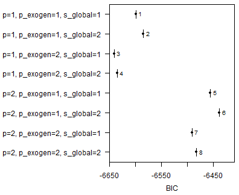
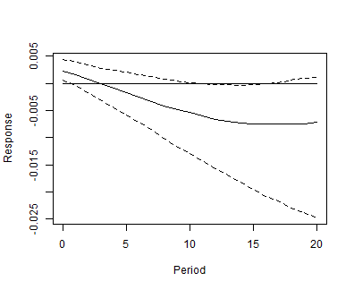
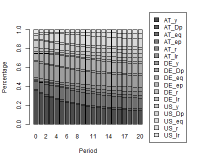

This vignette walks through a complete GVAR analysis: setting up the model,
specifying priors, simulating the posterior, choosing between competing
sub-model specifications, solving the global model and analysing it.

### Data

The `bgvars` packages comes with the updated GVAR database of Mohaddes and Raissi (2020), which contains economic time series for 33 countries and 3 commodities from 1979Q2 to 2019Q4.[^gvar2019]


``` r
#library(bgvars)
devtools::load_all(".")

# Load data
data("gvar2019")
global_data <- gvar2019[["global_data"]]
submodel_data <- gvar2019[["submodel_data"]]

# Limit number of sub-models
submodel_data <- select_list_elements(submodel_data, c("AT", "DE", "US"))
```

### Preparation


``` r
object <- create_gvarmodel(submodel_data = submodel_data,
                           global_data = global_data)
```

Weight matrices for each country/region can be calculated with the function `add_weight_matrices`.


``` r
# Generate weight matrices
object <- add_weight_matrices(object = object,
                              submodel_data = submodel_data,
                              period = 3)
```

A weight matrix links the vector of the endogenous variables of the global
model to the endogenous and weakly exogenous variables of one sub-model. It can
be inspected with `get_weight_matrix`.


``` r
w <- get_weight_matrix(object, "AT")
round(w[, 1:6], 3)
#>    AT_y AT_Dp AT_eq AT_ep AT_r AT_lr
#> y     1     0     0     0    0     0
#> Dp    0     1     0     0    0     0
#> eq    0     0     1     0    0     0
#> ep    0     0     0     1    0     0
#> r     0     0     0     0    1     0
#> lr    0     0     0     0    0     1
#> y     0     0     0     0    0     0
#> Dp    0     0     0     0    0     0
#> eq    0     0     0     0    0     0
#> ep    0     0     0     0    0     0
#> r     0     0     0     0    0     0
#> lr    0     0     0     0    0     0
```

The upper block picks out Austria's own variables, the lower block averages the
corresponding variables of the remaining countries.

### Model specification

Passing a vector rather than a single value to `p_endogen`, `p_exogen` or `s`
creates one sub-model per combination, all of which are estimated and compared
below.


``` r
object <- add_submodels(object,
                        p_endogen = 1:2,
                        exogen = c("y", "Dp", "eq", "r", "lr"),
                        p_exogen = 1:2,
                        global = "poil",
                        s = 1:2,
                        error = "wishart",
                        iterations = 2000,
                        burnin = 1000)
```

The resulting sub-models could have different sample sizes. Function `align_model_obs` can be employed to ensure that all sub-models use the same set of observations that are common to all sub-models.


``` r
object <- align_model_obs(object)
```


### Prior specification


``` r
object <- add_priors(object,
                     coef = list(v_i = 0),
                     sigma = list(df = 3, scale = 1e-8))
```

### Initial values


``` r
object <- add_initial_values(object)
```

### Posterior simulation

The draws are what makes a global model large. A sub-model with time varying
coefficients keeps a path per draw, a few hundred megabytes at a realistic
chain, so a model of thirty of them needs tens of gigabytes if its draws are
held in one session. They need not be: the sub-models of a global model are
independent of one another given the weight matrices, and the package works
through the export in a folder, one model at a time.

`write_to_hdf5` writes the model -- global data, weight matrices, a table
describing every sub-model file, and one HDF5 file per model, priors and
starting values included.


``` r
folder <- file.path(tempdir(), "gvar")
dir.create(folder, showWarnings = FALSE)

write_to_hdf5(object, folder = folder, overwrite = TRUE)
```

`read_export` returns a handle to that folder. It carries the table, not the
models.


``` r
export <- read_export(folder)

export
#> Export of a global model in C:\Users\mo_fr\AppData\Local\Temp\RtmpUxqhyf/gvar 
#> 24 models of 3 sub-models
#> 
#>  type   tvp   error varsel iterations burnin
#>  VARX FALSE wishart   none       2000   1000
```

The steps of the estimation are the same functions as for a model in memory.
Each of them reads a model, changes it, writes it back and drops it, so what a
step needs is one model per worker rather than the whole global model.


``` r
export <- add_seed(export, 20260919)
export <- add_posterior_coefficients(export, cores = 2)
export <- add_posterior_loglik(export, cores = 2)
```

The models are numbered through in the order of the table, and each is drawn
with a seed of its own, so the draws do not depend on how many workers the step
ran on.

Anything the package has no method for is a call to `map_submodels`, which is
what those methods are:


``` r
export <- map_submodels(export, function(model) {
  # ... whatever one model needs ...
  model
}, cores = 2)
```

#### Building a folder in batches

A folder can also be filled in several goes, which is what a run does when even
the unestimated sub-models are more than it wants to hold, or when a country is
added to a model that is already estimated. `append = TRUE` writes the
sub-models of an object into the folder beside the ones already there: their
files are added, or replaced where the folder holds them already, and their rows
are merged into the table, while the global data and the weight matrices stay as
the first write left them.


``` r
submodels <- names(object[["submodels"]])
batches <- split(submodels, rep(1:2, length.out = length(submodels)))

for (i in seq_along(batches)) {
  batch <- object
  batch[["submodels"]] <- object[["submodels"]][batches[[i]]]
  write_to_hdf5(batch, folder = folder, overwrite = i == 1, append = i > 1)
  rm(batch)
}
```

#### Estimating in memory

A model small enough to hold can be estimated as an object, which is the same
code without the folder.


``` r
object <- add_posterior_coefficients(object)
object <- add_posterior_loglik(object)
```

#### BayesTS

The files of the folder are also what an external sampler works on.
[BayesTS](https://github.com/franzmohr/BayesTS) is pointed at the folder of
sub-models and writes the posterior draws back into the files it read.


``` bash
bayests posterior /path/to/gvar/submodels
```

`bayests::bayests_posterior()` wraps the same executable as a
`posterior_function`, so a folder can be estimated with it through
`add_posterior_coefficients` above.

Every route leads to the same place: a folder of sub-model files that hold
posterior draws, which is what the rest of this vignette works on.

### Model selection

Model performance is evaluated for each sub-model. `read_submodel_from_folder`
reads the models of a single sub-model, which avoids holding the whole global
model in memory.


``` r
model <- read_submodel_from_folder(folder = folder, submodel = "AT")
```

The output of the function is an object of class `modellist`. Hence, `bvartools`'
functionality can be employed to evaluate model performance using `selection_criteria`.


``` r
sc <- selection_criteria(model)

plot(sc, criterion = "BIC")
```




``` r
choose_best_model(sc, criterion = "AIC")
#> [1] 8
```

The process can be automated using `choose_best_model_from_hdf5`, which ranks
the models of every sub-model without reading their posterior draws of the
coefficients.


``` r
best_models <- choose_best_model_from_hdf5(folder = folder,
                                           criterion = "BIC")

best_models
#>   submodel position
#> 1       AT        3
#> 2       DE        3
#> 3       US        4
```


Finally, import the global model with the final sub-models.

`read_gvar_from_folder` brings the whole model back, draws included. The
sub-models are found through the table in `model.h5` rather than through the
directory tree, so the names they are known by survive a folder that has been
moved or renamed. Passing the table of best models keeps one model per
sub-model, which is what solving the global model requires.


``` r
object <- read_gvar_from_folder(folder = folder,
                                submodels = best_models)
```

### Solve the model

The estimated sub-models can be combined and solved with the function `submodels_to_gvar`.


``` r
gvar <- submodels_to_gvar(object)
```

Stacking the sub-models gives the structural form
$G y_t = A_1 y_{t-1} + \dots + u_t$, in which $G$ collects the contemporaneous
coefficients and the weight matrices. `submodels_to_gvar` solves this for the
reduced form $y_t = G^{-1} A_1 y_{t-1} + \dots + G^{-1} u_t$, since that is the
representation the analysis below works on. The draws of $G$ are kept in element
`g` of the result.

The resulting object is of class `bvarmodel`, so the global model can be
evaluated and analysed as any other BVAR model.


``` r
gvar[["model"]][["k"]]
#> [1] 17
```

### Impulse response analysis

Generalised impulse responses are obtained with `irf` and `type = "gir"`.
`shock = "sd"` scales the shock to one standard deviation of the residual of
the impulse variable.


``` r
gvar_irf <- irf(gvar,
                impulse = "US_r", response = "AT_y",
                n_ahead = 20, ci = .68,
                type = "gir", shock = "sd")

plot(gvar_irf)
```



### Error variance decomposition


``` r
gvar_fevd <- fevd(gvar,
                  response = "AT_y",
                  n_ahead = 20,
                  type = "gir",
                  normalise_gir = TRUE)

plot(gvar_fevd)
```



## References

Chudik, A. & Pesaran, M. H. (2016). Theory and practice of GVAR modelling. *Journal of Economic Surveys 30*(1), 165-197. <https://doi.org/10.1111/joes.12095>

Dees, S., Mauro, F., Pesaran, M. H., & Smith, V. L. (2007). Exploring the international linkages of the euro area: A global VAR analysis. *Journal of Applied Econometrics 22*(1), 1-38. <https://doi.org/10.1002/jae.932>

George, E. I., Sun, D., & Ni, S. (2008). Bayesian stochastic search for VAR model restrictions. *Journal of Econometrics, 142*(1), 553-580. <https://doi.org/10.1016/j.jeconom.2007.08.017>

Koop, G., Pesaran, M. H., & Potter, S.M. (1996). Impulse response analysis in nonlinear multivariate models. *Journal of Econometrics 74*(1), 119-147. <https://doi.org/10.1016/0304-4076(95)01753-4>

Lütkepohl, H. (2007). *New introduction to multiple time series analysis* (2nd ed.). Berlin: Springer.

Mohaddes, K., & Raissi, M. (2020). Compilation, revision and updating of the global VAR (GVAR) database, 1979Q2--2019Q4 (mimeo). <https://www.mohaddes.org/gvar>.

Pesaran, H. H., & Shin, Y. (1998). Generalized impulse response analys is in linear multivariate models. *Economics Letters, 58*(1), 17-29. <https://doi.org/10.1016/S0165-1765(97)00214-0>

Pesaran, M., Schuermann, T., & Weiner, S. M. (2004). Modeling regional interdependencies using a global error-correcting macroeconometric model. *Journal of Business & Economic Statistics 22*(2), 129-162. <https://doi.org/10.1198/073500104000000019>

[^gvar2019]: The paper and data set can be downloaded from <https://www.mohaddes.org/gvar>.
