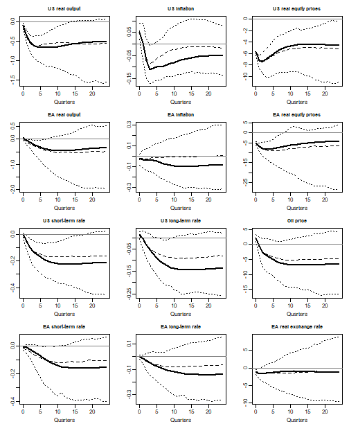
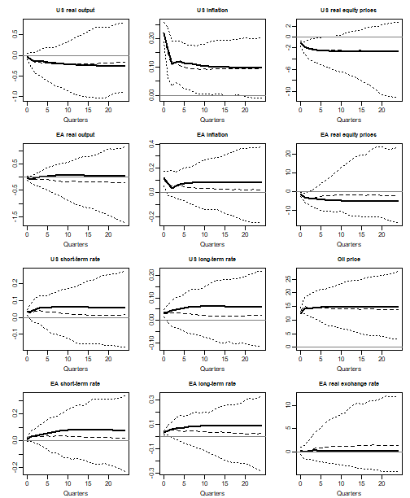
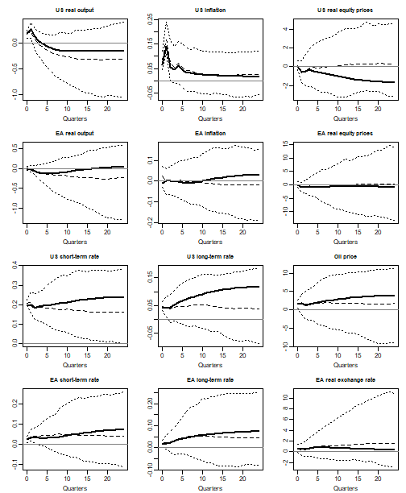

This vignette sets up, estimates and solves the global vector error correction
(GVEC) model of Dees, di Mauro, Pesaran and Smith (2007) with `bgvars`, and
compares the results with the paper and its Supplement B. The country models,
their lag orders and cointegration ranks are those of the paper.

The comparison has two parts. The paper's own statistics -- lag orders,
cointegration ranks, the maximum likelihood (ML) estimates, the stability of
the global model and its generalised impulse responses -- are computed from
the model `bgvars` sets up. Three of them are not functions of the package:
information criteria of the unrestricted country models, Johansen's trace
statistic with weakly exogenous regressors, and the generalised impulse
responses of eq. (21) of the paper, which shock the country residuals with
their full covariance. They take a few lines each, written out below. The
Bayesian estimates of the package, simulated with
[BayesTS](https://github.com/franzmohr/BayesTS), are then compared with them.

### Data

The package contains the data set of Dees et al. (2007): quarterly series for
26 economies from 1979Q2 to 2003Q4, the euro area among them as one economy,
and the price of oil. The variables are log real output `y`, inflation `Dp`,
the short- and long-term interest rates `rs` and `rl`, log real equity prices
`q` and the log real exchange rate `ep`. Not every economy has every variable,
as the table shows. The data of each economy also contain its annual trade
with each of the other economies from 1980 to 2003.


``` r
#library(bgvars)
devtools::load_all(".")
data("dees2007")

submodel_data <- dees2007[["submodel_data"]]
global_data <- dees2007[["global_data"]]

submodel_data
#>  submodel y Dp rs q ep rl
#>        AR x  x  x x  x   
#>        AU x  x  x x  x  x
#>        BR x  x  x    x   
#>        CA x  x  x x  x  x
#>        CN x  x  x    x   
#>        CL x  x  x x  x   
#>        IN x  x  x x  x   
#>        ID x  x  x    x   
#>        JP x  x  x x  x  x
#>        KR x  x  x x  x  x
#>        MY x  x  x x  x   
#>        MX x  x  x    x   
#>        NO x  x  x x  x  x
#>        NZ x  x  x x  x  x
#>        PE x  x  x    x   
#>        PH x  x  x x  x   
#>        ZA x  x  x x  x  x
#>        SA x  x       x   
#>        SG x  x  x x  x   
#>        SE x  x  x x  x  x
#>        CH x  x  x x  x  x
#>        TH x  x  x x  x   
#>        TR x  x  x    x   
#>        GB x  x  x x  x  x
#>        US x  x  x x     x
#>        EA x  x  x x  x  x
```

The price of oil is an endogenous variable of the US model. It is added to the
US series, so that the other economies take it from the US model as a weakly
exogenous variable.


``` r
vars_us <- c(dimnames(submodel_data[["US"]][["endogen"]])[[2]], "poil")
submodel_data[["US"]][["endogen"]] <- cbind(submodel_data[["US"]][["endogen"]], global_data)
dimnames(submodel_data[["US"]][["endogen"]])[[2]] <- vars_us
```

### Weights

The foreign variables of an economy are averages of the other economies'
series, weighted by its trade with them over 1999-2001.


``` r
object <- create_gvecmodel(submodel_data = submodel_data)
object <- add_weight_matrices(object = object,
                              submodel_data = submodel_data,
                              period = 1999:2001)
```

The first two rows of Table B1 of the supplement give the weights of the US and
the euro area.


``` r
table_b1 <- rbind(
  US = c(US = 0.000, EA = 0.155, CN = 0.073, JP = 0.124, GB = 0.052, SE = 0.008,
         CH = 0.012, NO = 0.004, AR = 0.005, BR = 0.018, CL = 0.004, MX = 0.141,
         PE = 0.002, AU = 0.011, CA = 0.241, NZ = 0.003, ID = 0.008, KR = 0.038,
         MY = 0.021, PH = 0.013, SG = 0.022, TH = 0.014, IN = 0.009, ZA = 0.004,
         SA = 0.012, TR = 0.004),
  EA = c(US = 0.227, EA = 0.000, CN = 0.056, JP = 0.072, GB = 0.238, SE = 0.057,
         CH = 0.090, NO = 0.028, AR = 0.008, BR = 0.023, CL = 0.005, MX = 0.013,
         PE = 0.001, AU = 0.012, CA = 0.019, NZ = 0.002, ID = 0.009, KR = 0.021,
         MY = 0.013, PH = 0.007, SG = 0.016, TH = 0.011, IN = 0.014, ZA = 0.014,
         SA = 0.014, TR = 0.028))

trade_weights <- t(sapply(c("US", "EA"), function(i) {
  trade <- colSums(window(submodel_data[[i]][["weights"]], start = 1999, end = 2001))
  trade / sum(trade)
}))

max(abs(round(trade_weights[, colnames(table_b1)], 3) - table_b1))
#> [1] 0
```

Rounded to three decimals, the weights are those of the table.

### Model specification

Table B9 of the supplement gives the lag order `p` of the domestic and `q` of the
foreign variables of each country model and its cointegration rank `r`.


``` r
table_b9 <- data.frame(
  submodel = c("US", "EA", "CN", "JP", "GB", "SE", "CH", "NO", "AR", "BR",
               "CL", "MX", "PE", "AU", "CA", "NZ", "ID", "KR", "MY", "PH",
               "SG", "TH", "IN", "ZA", "SA", "TR"),
  p = c(2, 2, 2, 1, 2, 2, 1, 2, 2, 2, 2, 1, 2, 1, 1, 2, 2, 2, 2, 2, 2, 1, 2, 2, 2, 2),
  q = c(2, 2, 1, 1, 1, 1, 1, 1, 1, 1, 1, 1, 1, 1, 1, 1, 1, 1, 1, 1, 1, 1, 1, 1, 1, 1),
  r = c(2, 2, 1, 4, 3, 3, 3, 2, 2, 1, 2, 3, 3, 4, 4, 3, 3, 4, 1, 2, 3, 3, 2, 1, 1, 1))
```

Every country model is a VECX\* model with an unrestricted constant and a trend
restricted to the cointegration space, case IV of Pesaran, Shin and Smith (2000).
The US model contains output, inflation, both interest rates, equity prices and
the oil price, and takes foreign output, inflation and the exchange rate as
weakly exogenous. The other models contain whichever of the six domestic
variables are available, and take foreign output, inflation, equity prices,
interest rates and the oil price as weakly exogenous. A VARX\*(p, q) model in
levels is a VECX\* model with `p_endogen = p` and `p_exogen = q + 1`. The lag
orders of `create_vecxsubmodel` are those of the model in levels and, as in
`create_varxsubmodel`, count the weakly exogenous variables from the
contemporaneous term onwards.


``` r
endogen_of <- function(submodel) {
  if (submodel == "US") c("y", "Dp", "rs", "rl", "q", "poil") else c("y", "Dp", "rs", "rl", "q", "ep")
}
exogen_of <- function(submodel) {
  if (submodel == "US") c("y", "Dp", "ep") else c("y", "Dp", "q", "rs", "rl", "poil")
}

for (i in seq_len(nrow(table_b9))) {
  submodel <- table_b9[i, "submodel"]
  object[["submodels"]][[submodel]] <- create_vecxsubmodel(object,
    submodel = submodel,
    endogen = endogen_of(submodel), p_endogen = table_b9[i, "p"],
    exogen = exogen_of(submodel), p_exogen = table_b9[i, "q"] + 1,
    r = table_b9[i, "r"],
    const = "unrestricted", trend = "restricted",
    iterations = 10000, burnin = 2000)
}
```

The models with a single lag keep one more observation than the others.
`align_model_obs` puts all of them on the sample they have in common,
1979Q4-2003Q4, which is the sample the statistics of the paper are computed on.


``` r
object <- align_model_obs(object)
stats::tsp(object[["submodels"]][["JP"]][[1]][["data"]][["train"]][["y"]])
#> [1] 1979.75 2003.75    4.00
```

### Lag orders

The paper chooses the lag orders by the Akaike information criterion (AIC) of
the unrestricted VARX\*(p, q) model, with p and q at most two. In levels that
model is the error correction model with an unrestricted matrix on the lagged
levels, so its likelihood is that of a regression of the differences on all
regressors of the sub-model. The criteria follow the convention of Microfit,
where the log-likelihood less the number of parameters is maximised.


``` r
information_criteria <- function(model) {
  y <- model[["data"]][["train"]][["y"]]
  regressors <- cbind(model[["data"]][["train"]][["w"]], model[["data"]][["train"]][["x"]])
  u <- qr.resid(qr(regressors), y)
  tt <- nrow(y)
  k <- ncol(y)
  loglik <- -tt * k / 2 * (1 + log(2 * pi)) -
    tt / 2 * as.numeric(determinant(crossprod(u) / tt)$modulus)
  n_par <- k * ncol(regressors)
  c(p = model[["model"]][["p_endogen"]], q = model[["model"]][["p_exogen"]] - 1,
    aic = loglik - n_par, sbc = loglik - n_par / 2 * log(tt))
}

lag_orders <- do.call(rbind, lapply(table_b9[["submodel"]], function(submodel) {
  candidates <- create_vecxsubmodel(object, submodel = submodel,
                                    endogen = endogen_of(submodel), p_endogen = 1:2,
                                    exogen = exogen_of(submodel), p_exogen = 2:3,
                                    r = 0, const = "unrestricted", trend = "restricted")
  ic <- as.data.frame(t(sapply(candidates, information_criteria)))
  paper <- table_b9[table_b9[["submodel"]] == submodel, ]
  given_q <- ic[ic[["q"]] == paper[["q"]], ]
  data.frame(submodel = submodel, p_paper = paper[["p"]], q_paper = paper[["q"]],
             p_aic = given_q[which.max(given_q[["aic"]]), "p"],
             p_sbc = given_q[which.max(given_q[["sbc"]]), "p"])
}))

head(lag_orders)
#>   submodel p_paper q_paper p_aic p_sbc
#> 1       US       2       2     2     1
#> 2       EA       2       2     2     1
#> 3       CN       2       1     2     2
#> 4       JP       1       1     1     1
#> 5       GB       2       1     2     1
#> 6       SE       2       1     2     1
```

All candidates of a country use the same observations, since
`create_vecxsubmodel` builds them on the sample of the longest lags. Given the
paper's q, the AIC chooses the paper's p for
26 of the 26 models. The
Schwarz criterion would choose it for
11, so the AIC is the
criterion the paper used.

### Cointegration ranks

The trace statistic for models with weakly exogenous I(1) regressors
(Pesaran, Shin and Smith, 2000) is computed from the reduced rank regression of
the differences on the lagged levels in `data$train$w`, both corrected for the
short-run regressors in `data$train$x`.


``` r
trace_statistics <- function(model) {
  y <- unclass(model[["data"]][["train"]][["y"]])
  w <- unclass(model[["data"]][["train"]][["w"]])
  x <- unclass(model[["data"]][["train"]][["x"]])
  tt <- nrow(y)
  qx <- qr(x)
  r0 <- qr.resid(qx, y)
  r1 <- qr.resid(qx, w)
  s00 <- crossprod(r0) / tt
  s01 <- crossprod(r0, r1) / tt
  s11 <- crossprod(r1) / tt
  lambda <- eigen(solve(s11, t(s01)) %*% solve(s00, s01), only.values = TRUE)[["values"]]
  lambda <- sort(Re(lambda), decreasing = TRUE)[1:ncol(y)]
  # Statistics for H0: r = 0, r <= 1, ..., r <= k - 1
  -tt * rev(cumsum(rev(log(1 - lambda))))
}
```

Tables B4-B8 of the supplement give the statistics, and the 95% critical values
depend on the number of unit roots under the null hypothesis and on the number
of weakly exogenous I(1) variables, three in the US model and six elsewhere.


``` r
table_b4_b8 <- list(
  US = c(221.46, 130.18, 79.09, 43.62, 22.60, 6.31),
  EA = c(248.38, 168.51, 112.48, 72.62, 40.37, 16.92),
  JP = c(425.31, 224.10, 136.81, 92.41, 54.77, 19.94),
  GB = c(347.78, 208.46, 135.20, 82.57, 44.61, 17.15),
  SE = c(265.44, 188.96, 120.44, 81.84, 47.57, 18.96),
  CH = c(310.00, 211.69, 129.85, 67.01, 34.64, 16.73),
  NO = c(282.75, 173.54, 106.78, 61.05, 32.72, 12.13),
  AU = c(305.63, 218.10, 147.83, 95.01, 50.18, 17.06),
  CA = c(374.76, 265.47, 165.38, 105.34, 54.20, 19.57),
  NZ = c(281.16, 184.02, 120.32, 69.75, 35.40, 16.91),
  KR = c(314.16, 223.60, 156.29, 100.38, 49.30, 22.21),
  ZA = c(212.91, 152.55, 95.48, 49.77, 23.36, 7.49),
  AR = c(187.18, 122.28, 77.39, 36.68, 10.23),
  CL = c(209.45, 133.43, 79.10, 44.11, 16.54),
  MY = c(172.31, 110.53, 59.26, 28.53, 9.63),
  PH = c(229.18, 129.99, 75.28, 42.54, 14.65),
  SG = c(244.53, 162.04, 93.57, 41.65, 8.95),
  TH = c(292.28, 185.96, 110.18, 52.49, 21.17),
  IN = c(220.18, 121.87, 72.02, 34.00, 12.97),
  CN = c(124.02, 69.83, 42.62, 17.13),
  BR = c(146.25, 78.31, 37.86, 15.39),
  MX = c(178.48, 98.86, 60.03, 24.57),
  PE = c(180.83, 117.43, 61.68, 20.11),
  ID = c(173.90, 109.19, 62.02, 18.45),
  TR = c(148.62, 73.82, 40.16, 14.11),
  SA = c(117.07, 52.61, 22.19))

# 95% critical values, indexed by the number of unit roots under H0
critical_values <- list(US = c(20.98, 41.03, 64.54, 91.81, 122.96, 158.01),
                        other = c(28.81, 55.50, 85.44, 119.03, 156.44, 197.70))
```

The rank is the number of hypotheses that are rejected before the first that
is not.


``` r
trace_tables <- lapply(table_b9[["submodel"]], function(submodel) {
  trace <- trace_statistics(object[["submodels"]][[submodel]][[1]])
  k <- length(trace)
  cv <- rev(critical_values[[if (submodel == "US") "US" else "other"]][1:k])
  data.frame(submodel = submodel, h0 = paste0("r <= ", 0:(k - 1)),
             trace = trace, paper = table_b4_b8[[submodel]], cv95 = cv)
})
names(trace_tables) <- table_b9[["submodel"]]

ranks <- do.call(rbind, lapply(trace_tables, function(x) {
  data.frame(submodel = x[1, "submodel"],
             r_paper = table_b9[table_b9[["submodel"]] == x[1, "submodel"], "r"],
             r = sum(cumprod(x[["trace"]] > x[["cv95"]])),
             max_abs_diff = max(abs(x[["trace"]] - x[["paper"]])))
}))
rownames(ranks) <- NULL

knitr::kable(trace_tables[["US"]], digits = 2, row.names = FALSE)
```


|submodel |h0     |  trace|  paper|   cv95|
|:--------|:------|------:|------:|------:|
|US       |r <= 0 | 221.46| 221.46| 158.01|
|US       |r <= 1 | 130.18| 130.18| 122.96|
|US       |r <= 2 |  79.09|  79.09|  91.81|
|US       |r <= 3 |  43.62|  43.62|  64.54|
|US       |r <= 4 |  22.60|  22.60|  41.03|
|US       |r <= 5 |   6.31|   6.31|  20.98|


``` r
knitr::kable(trace_tables[["EA"]], digits = 2, row.names = FALSE)
```


|submodel |h0     |  trace|  paper|   cv95|
|:--------|:------|------:|------:|------:|
|EA       |r <= 0 | 248.38| 248.38| 197.70|
|EA       |r <= 1 | 168.51| 168.51| 156.44|
|EA       |r <= 2 | 112.48| 112.48| 119.03|
|EA       |r <= 3 |  72.62|  72.62|  85.44|
|EA       |r <= 4 |  40.37|  40.37|  55.50|
|EA       |r <= 5 |  16.92|  16.92|  28.81|


All 134 trace statistics are within
0.0049 of the supplement, and the
rank chosen at the 95% critical value is the rank of Table B9 for
26 of the 26 models.

### Maximum likelihood estimates

The priors below are flat on the coefficients and on the cointegration space,
with an uninformative Wishart prior on the error covariance.
`add_initial_values` starts every chain at the reduced rank ML estimate of its
sub-model, and those are the estimates of the paper.


``` r
object <- add_priors(object,
                     coef = list(v_i = 0),
                     coint = list(v_i = 0, p_tau_i = 1),
                     sigma = list(df = 3, scale = 0.0001))
object <- add_initial_values(object)
```

Table B11 of the supplement reports the contemporaneous effect of each foreign
variable on its domestic counterpart, with t-ratios based on White's
heteroskedasticity-consistent standard errors.


``` r
table_b11 <- utils::read.csv(text = "
submodel,variable,coef,t
US,y,0.54,3.12
US,Dp,0.06,0.87
EA,y,0.53,4.03
EA,Dp,0.25,3.31
EA,q,1.15,8.90
EA,rs,0.09,3.84
EA,rl,0.63,7.86
CN,y,-0.10,-0.66
CN,Dp,0.61,2.30
CN,rs,0.12,2.27
JP,y,0.50,3.47
JP,Dp,-0.04,-0.38
JP,q,0.67,5.53
JP,rs,-0.05,-0.89
JP,rl,0.48,4.84
GB,y,0.33,2.33
GB,Dp,-0.15,-0.64
GB,q,0.84,13.28
GB,rs,0.27,1.48
GB,rl,0.67,4.85
SE,y,1.19,3.38
SE,Dp,1.23,6.19
SE,q,1.15,11.60
SE,rs,1.25,3.56
SE,rl,0.96,5.75
CH,y,0.47,3.81
CH,Dp,0.52,3.68
CH,q,0.70,2.17
CH,rs,0.16,3.10
CH,rl,0.41,5.88
NO,y,0.80,2.05
NO,Dp,1.11,6.84
NO,q,1.03,8.62
NO,rs,0.15,0.85
NO,rl,0.56,3.43
AR,y,0.26,1.08
AR,Dp,-1.54,-0.87
AR,q,1.31,2.88
AR,rs,3.31,1.99
BR,y,0.57,1.52
BR,Dp,0.82,1.06
BR,rs,1.43,0.93
CL,y,0.41,1.24
CL,Dp,-0.01,-0.30
CL,q,0.44,2.74
CL,rs,0.04,1.67
MX,y,0.47,2.28
MX,Dp,1.12,1.79
MX,rs,-0.05,-0.06
PE,y,-0.06,-0.11
PE,Dp,1.73,0.59
PE,rs,-0.97,-0.70
AU,y,0.52,2.70
AU,Dp,0.51,3.10
AU,q,0.94,4.93
AU,rs,0.42,3.16
AU,rl,0.86,5.33
CA,y,0.44,3.63
CA,Dp,0.73,4.89
CA,q,1.13,13.70
CA,rs,0.53,3.43
CA,rl,0.98,15.67
NZ,y,0.62,2.43
NZ,Dp,0.23,0.89
NZ,q,1.06,6.28
NZ,rs,0.40,1.16
NZ,rl,0.24,1.18
ID,y,0.44,1.05
ID,Dp,-0.41,-0.74
ID,rs,1.09,1.73
KR,y,0.53,1.32
KR,Dp,0.95,3.05
KR,q,0.80,3.50
KR,rs,-0.16,-1.42
KR,rl,0.06,0.18
MY,y,1.48,4.84
MY,Dp,0.43,1.97
MY,q,1.20,2.66
MY,rs,0.08,0.50
PH,y,-0.04,-0.11
PH,Dp,-0.91,-2.02
PH,q,1.76,5.66
PH,rs,1.14,2.58
SG,y,0.98,4.17
SG,Dp,0.39,2.69
SG,q,0.16,0.93
SG,rs,0.52,2.96
TH,y,-0.07,-0.27
TH,Dp,1.11,4.34
TH,q,0.98,6.69
TH,rs,0.89,2.14
IN,y,0.74,2.35
IN,Dp,-0.29,-0.66
IN,q,0.74,4.38
IN,rs,-0.30,-1.07
ZA,y,0.15,0.88
ZA,Dp,0.22,0.74
ZA,q,1.00,7.54
ZA,rs,0.06,0.64
ZA,rl,0.32,1.22
SA,y,0.74,1.50
SA,Dp,0.23,1.23
TR,y,0.87,1.38
TR,Dp,8.60,8.13
TR,rs,1.80,1.57
", strip.white = TRUE)
```

In a sub-model, the coefficients `a` start with the `k * r` loadings, followed by
`k` coefficients per column of `data$train$x`. The contemporaneous effect of
foreign variable `v` is the coefficient on `d.v.s.00` in the equation of `d.v`.
Its standard error is White's, with the small-sample factor T / (T - K).


``` r
counterparts <- function(model) {
  vars <- c("y", "Dp", "q", "rs", "rl")
  vars[paste0("d.", vars) %in% dimnames(model[["data"]][["train"]][["y"]])[[2]] &
         paste0("d.", vars, ".s.00") %in% dimnames(model[["data"]][["train"]][["x"]])[[2]]]
}

coef_position <- function(model, variable) {
  k <- model[["model"]][["k"]]
  j <- match(paste0("d.", variable, ".s.00"), dimnames(model[["data"]][["train"]][["x"]])[[2]])
  i <- match(paste0("d.", variable), dimnames(model[["data"]][["train"]][["y"]])[[2]])
  k * model[["model"]][["rank"]] + (j - 1) * k + i
}

ml_effects <- function(model) {
  y <- unclass(model[["data"]][["train"]][["y"]])
  w <- unclass(model[["data"]][["train"]][["w"]])
  x <- unclass(model[["data"]][["train"]][["x"]])
  k <- ncol(y)
  a <- matrix(model[["initial"]][["a"]], k)
  beta <- matrix(model[["initial"]][["beta"]], ncol(w))
  regressors <- cbind(w %*% beta, x)
  u <- y - regressors %*% t(a)
  xtx_inv <- solve(crossprod(regressors))
  tt <- nrow(regressors)
  do.call(rbind, lapply(counterparts(model), function(v) {
    pos <- coef_position(model, v)
    i <- (pos - 1) %% k + 1
    j <- (pos - 1) %/% k + 1
    meat <- crossprod(regressors * u[, i])
    se <- sqrt((xtx_inv %*% meat %*% xtx_inv)[j, j] * tt / (tt - ncol(regressors)))
    data.frame(variable = v, ml = a[i, j], t_ml = a[i, j] / se)
  }))
}

effects <- do.call(rbind, lapply(table_b9[["submodel"]], function(submodel) {
  cbind(submodel = submodel, ml_effects(object[["submodels"]][[submodel]][[1]]))
}))
effects <- merge(table_b11, effects, sort = FALSE)

# Rounding half away from zero, as a spreadsheet does. round() rounds half to
# even, and works on the binary value, so it can differ in the last digit.
round_half_up <- function(x, digits) sign(x) * floor(abs(x) * 10^digits + 0.5) / 10^digits
same_as_table <- abs(round_half_up(round_half_up(effects[["ml"]], 3), 2) - effects[["coef"]]) < 1e-8

knitr::kable(effects[effects[["submodel"]] %in% c("US", "EA"), ], digits = 2, row.names = FALSE)
```


|submodel |variable | coef|    t|   ml| t_ml|
|:--------|:--------|----:|----:|----:|----:|
|US       |y        | 0.54| 3.12| 0.54| 3.12|
|US       |Dp       | 0.06| 0.87| 0.06| 0.87|
|EA       |y        | 0.53| 4.03| 0.53| 4.03|
|EA       |Dp       | 0.25| 3.31| 0.25| 3.31|
|EA       |q        | 1.15| 8.90| 1.15| 8.90|
|EA       |rs       | 0.09| 3.84| 0.09| 3.84|
|EA       |rl       | 0.63| 7.86| 0.62| 7.86|


All 105 coefficients are within
0.0054 of Table B11.
Rounded half away from zero to three decimals and then to two, which is
evidently how the table was produced, 105 of them are the
published numbers. The largest difference between the t-ratios is
0.0054.

### Stability of the global model

`submodels_to_gvar` solves the global model draw by draw. To solve it at the ML
estimates, they are entered as a single posterior draw of each sub-model.


``` r
ml <- object
for (submodel in names(ml[["submodels"]])) {
  model <- ml[["submodels"]][[submodel]][[1]]
  model[["posterior"]] <- list(
    a = list(coeffs = coda::mcmc(t(model[["initial"]][["a"]]))),
    beta = list(coeffs = coda::mcmc(t(model[["initial"]][["beta"]]))),
    u_sigma_inv = list(coeffs = coda::mcmc(t(as.vector(model[["initial"]][["u_sigma_inv"]])))))
  ml[["submodels"]][[submodel]][[1]] <- model
}
gvar_ml <- submodels_to_gvar(ml)
```

The paper reports 71 unit roots of the companion matrix of the global model,
and 0.907389, 0.884077 and 0.879361 as the largest of the remaining moduli.


``` r
companion_moduli <- function(gvar, draw = 1) {
  k <- gvar[["model"]][["k"]]
  p <- gvar[["model"]][["p"]]
  a <- matrix(gvar[["posterior"]][["a"]][["coeffs"]][draw, 1:(k * k * p)], k)
  companion <- rbind(a, cbind(diag(k * (p - 1)), matrix(0, k * (p - 1), k)))
  sort(Mod(eigen(companion, only.values = TRUE)[["values"]]), decreasing = TRUE)
}

moduli_ml <- companion_moduli(gvar_ml)
unit_roots <- abs(moduli_ml - 1) < 1e-6
sum(unit_roots)
#> [1] 71
# A complex pair shares its modulus, and the paper lists each modulus once
unique(round(moduli_ml[!unit_roots], 6))[1:3]
#> [1] 0.907390 0.884077 0.879361
```

The global model at the ML estimates has
71 unit roots, and its largest remaining moduli differ from the
paper's by at most
1e-06.

### Bayesian estimation

The series in the error correction term of a sub-model are on very different
scales, while the prior on the cointegration space treats them alike.
`scale_error_correction` divides them by the standard deviation of their
differences, and `rescale_error_correction` puts the series and the draws back on
the scale of the data after the simulation. The transformation is exact, so the
model is the same, but it changes what the prior says, which is why it is a step
of its own.

Given the weight matrices, the sub-models of a global model are independent of
one another, which makes it possible to estimate them outside R.
`write_to_hdf5` exports the model to a folder, one HDF5 file per sub-model
beside a `model.h5` holding the global data, the weight matrices and a table
describing every sub-model file. BayesTS is pointed at the folder of sub-models
and writes the posterior draws back into the files it read, and
`read_gvar_from_folder` brings the whole model back, draws and scaling factors
included.


``` r
object <- scale_error_correction(object)

folder <- "D:/models/dees2007/vignette"
dir.create(folder, showWarnings = FALSE)
write_to_hdf5(object, folder = folder, overwrite = TRUE)

status <- system2("D:/BayesTS/bin/bayests.exe",
                  c("posterior", shQuote(file.path(folder, "submodels"))))
if (status != 0) stop("BayesTS failed with status ", status, ".")

object <- read_gvar_from_folder(folder)
object <- rescale_error_correction(object)
```

The same simulation runs inside R with `add_posterior_coefficients(object)` in
place of the export, the call to BayesTS and the import.


``` r
posterior <- do.call(rbind, lapply(table_b9[["submodel"]], function(submodel) {
  model <- object[["submodels"]][[submodel]][[1]]
  do.call(rbind, lapply(counterparts(model), function(v) {
    draws <- as.numeric(model[["posterior"]][["a"]][["coeffs"]][, coef_position(model, v)])
    data.frame(submodel = submodel, variable = v, post_mean = mean(draws),
               q05 = unname(stats::quantile(draws, 0.05)),
               q95 = unname(stats::quantile(draws, 0.95)))
  }))
}))
effects <- merge(effects, posterior, sort = FALSE)

knitr::kable(effects[effects[["submodel"]] %in% c("US", "EA"), ], digits = 2, row.names = FALSE)
```


|submodel |variable | coef|    t|   ml| t_ml| post_mean|   q05|  q95|
|:--------|:--------|----:|----:|----:|----:|---------:|-----:|----:|
|US       |y        | 0.54| 3.12| 0.54| 3.12|      0.58|  0.30| 0.86|
|US       |Dp       | 0.06| 0.87| 0.06| 0.87|      0.09| -0.03| 0.21|
|EA       |y        | 0.53| 4.03| 0.53| 4.03|      0.54|  0.31| 0.76|
|EA       |Dp       | 0.25| 3.31| 0.25| 3.31|      0.26|  0.09| 0.43|
|EA       |q        | 1.15| 8.90| 1.15| 8.90|      1.17|  1.03| 1.30|
|EA       |rs       | 0.09| 3.84| 0.09| 3.84|      0.08|  0.01| 0.15|
|EA       |rl       | 0.63| 7.86| 0.62| 7.86|      0.63|  0.32| 0.94|


Every sub-model has 10000
draws. For 105
of the 105 coefficients the value of Table B11 lies inside the 90%
posterior interval, and the posterior means correlate with the table at
0.984. The
median absolute difference between posterior mean and ML estimate is
0.043.
With flat priors on the loadings and the short-run coefficients, their posterior
given a draw of the cointegration space is centred on the least squares estimate
for that space, and the ML estimate is that estimate at the ML space. The
posterior mean averages over a posterior of the space that the flat prior leaves
diffuse, which is where the two part.

### Generalised impulse responses

The paper's generalised impulse responses, eq. (21), are responses to a one
standard error shock to a' u_t, where u_t are the residuals of the country
models, stacked, and a is a unit vector for the shock to a single variable.
With G the matrix of contemporaneous coefficients of the global model, the
impact is G^-1 Sigma_u a / (a' Sigma_u a)^(1/2), and later horizons follow from
the reduced form. Sigma_u is the full covariance of the country residuals,
cross-country blocks included.

`irf(type = "gir")` computes something else for the solved model: it shocks the
errors of the reduced form, G^-1 u_t, whose covariance `submodels_to_gvar`
assembles from block diagonal country covariances. The responses of the paper
are therefore computed directly. Since u_t = G e_t for the reduced form residuals
e_t, G^-1 Sigma_u a = Sigma_e G' a and a' Sigma_u a = (G' a)' Sigma_e (G' a).


``` r
paper_girf <- function(gvar, impulse, response, n_ahead = 24) {
  k <- gvar[["model"]][["k"]]
  p <- gvar[["model"]][["p"]]
  y <- unclass(gvar[["data"]][["train"]][["y"]])
  x <- unclass(gvar[["data"]][["train"]][["x"]])
  tt <- nrow(y)
  keep <- match(response, gvar[["model"]][["endogen"]])
  draws <- nrow(gvar[["posterior"]][["a"]][["coeffs"]])
  result <- array(NA_real_, c(draws, n_ahead + 1, length(keep), ncol(impulse)),
                  dimnames = list(NULL, 0:n_ahead, response, colnames(impulse)))
  moduli <- numeric(draws)
  for (d in 1:draws) {
    b <- matrix(gvar[["posterior"]][["a"]][["coeffs"]][d, ], k)
    sigma_e <- crossprod(y - x %*% t(b)) / tt
    g <- matrix(gvar[["g"]][d, ], k)
    ga <- crossprod(g, impulse)
    impact <- sigma_e %*% ga
    psi <- array(0, c(n_ahead + 1, k, ncol(impulse)))
    psi[1, , ] <- sweep(impact, 2, sqrt(colSums(ga * impact)), "/")
    for (h in 1:n_ahead) {
      for (j in 1:min(h, p)) {
        psi[h + 1, , ] <- psi[h + 1, , ] + b[, (j - 1) * k + 1:k] %*% psi[h - j + 1, , ]
      }
    }
    result[d, , , ] <- psi[, keep, , drop = FALSE] * 100
    moduli[d] <- companion_moduli(gvar, d)[1]
  }
  list(girf = result, max_modulus = moduli)
}
```

Figures 1-3 of the paper show a negative shock to US equity prices, a positive
shock to the oil price and a positive shock to the US short-term interest rate.


``` r
endogen <- gvar_ml[["model"]][["endogen"]]
unit_shock <- function(variable, sign) {
  a <- numeric(length(endogen))
  a[match(variable, endogen)] <- sign
  a
}
impulse <- cbind(us_equity = unit_shock("US_q", -1),
                 oil = unit_shock("US_poil", 1),
                 us_short_rate = unit_shock("US_rs", 1))
panels <- c("US_y", "US_Dp", "US_q", "EA_y", "EA_Dp", "EA_q",
            "US_rs", "US_rl", "US_poil", "EA_rs", "EA_rl", "EA_ep")

girf_ml <- paper_girf(gvar_ml, impulse, panels)
```

For the posterior, every tenth draw is used. A draw of the global model whose
companion matrix has a root outside the unit circle has no impulse responses
that die out, so only stable draws are summarised.


``` r
thinned <- object
thinned[["submodels"]] <- lapply(object[["submodels"]], function(models) {
  models[[1]] <- thin(models[[1]], thin = 10)
  models
})
gvar_post <- submodels_to_gvar(thinned)
girf_post <- paper_girf(gvar_post, impulse, panels)
stable <- girf_post[["max_modulus"]] < 1 + 1e-6
```

Only 236 of the 1000 draws give a stable global model,
and the median of the largest modulus is
1.037. Like the gap
between posterior and ML estimates, this comes from how weakly the data
determine the cointegration spaces: a drawn space far from the ML space leaves
combinations of the variables that are not stationary.


``` r
titles <- c(US_y = "US real output", US_Dp = "US inflation", US_q = "US real equity prices",
            EA_y = "EA real output", EA_Dp = "EA inflation", EA_q = "EA real equity prices",
            US_rs = "US short-term rate", US_rl = "US long-term rate", US_poil = "Oil price",
            EA_rs = "EA short-term rate", EA_rl = "EA long-term rate", EA_ep = "EA real exchange rate")

plot_girf <- function(shock) {
  oldpar <- graphics::par(mfrow = c(4, 3), mar = c(3, 3, 2.5, 1), mgp = c(1.8, 0.6, 0))
  on.exit(graphics::par(oldpar))
  horizons <- 0:(dim(girf_ml[["girf"]])[2] - 1)
  for (v in panels) {
    ml_path <- girf_ml[["girf"]][1, , v, shock]
    bands <- apply(girf_post[["girf"]][stable, , v, shock, drop = FALSE], 2,
                   stats::quantile, probs = c(0.05, 0.5, 0.95))
    graphics::plot(horizons, ml_path, type = "l", lwd = 2,
                   ylim = range(c(ml_path, bands, 0)),
                   xlab = "Quarters", ylab = "", main = titles[[v]], cex.main = 0.9)
    graphics::lines(horizons, bands[2, ], lty = 2)
    graphics::lines(horizons, bands[1, ], lty = 3)
    graphics::lines(horizons, bands[3, ], lty = 3)
    graphics::abline(h = 0, col = "grey50")
  }
}
```

In the figures, the solid line is the response at the ML estimates, the dashed
line the posterior median and the dotted lines the 90% credible bounds of the
stable draws, all in per cent.


``` r
plot_girf("us_equity")
```




``` r
plot_girf("oil")
```




``` r
plot_girf("us_short_rate")
```



The responses at the ML estimates have the shapes of Figures 1-3: the fall in
US equity prices lowers output, equity prices and interest rates in both
regions, the oil shock raises inflation on impact, and the US short rate shock
comes with the paper's price puzzle. Section 6 of the paper quotes the
following numbers from its bootstrap means.


``` r
section_6 <- data.frame(
  quantity = c("US equity shock: US equity prices, impact",
               "US equity shock: US output, impact",
               "US equity shock: US output, quarters 1-4",
               "US equity shock: US output, quarters 5-8",
               "US equity shock: EA equity prices, impact",
               "Oil shock: oil price, impact",
               "US short rate shock: US short rate, impact"),
  paper = c("-4 to -5", "about -0.1", "-0.4", "-0.5", "about -4.0", "10 to 11", "0.2"),
  shock = c("us_equity", "us_equity", "us_equity", "us_equity", "us_equity", "oil", "us_short_rate"),
  variable = c("US_q", "US_y", "US_y", "US_y", "EA_q", "US_poil", "US_rs"),
  from = c(0, 0, 1, 5, 0, 0, 0),
  to = c(0, 0, 4, 8, 0, 0, 0))

section_6[["ml"]] <- mapply(function(shock, variable, from, to) {
  mean(girf_ml[["girf"]][1, as.character(from:to), variable, shock])
}, section_6[["shock"]], section_6[["variable"]], section_6[["from"]], section_6[["to"]])
section_6[["posterior"]] <- mapply(function(shock, variable, from, to) {
  mean(girf_post[["girf"]][stable, as.character(from:to), variable, shock])
}, section_6[["shock"]], section_6[["variable"]], section_6[["from"]], section_6[["to"]])

knitr::kable(section_6[, c("quantity", "paper", "ml", "posterior")], digits = 2, row.names = FALSE)
```


|quantity                                   |paper      |    ml| posterior|
|:------------------------------------------|:----------|-----:|---------:|
|US equity shock: US equity prices, impact  |-4 to -5   | -5.65|     -5.95|
|US equity shock: US output, impact         |about -0.1 | -0.10|     -0.11|
|US equity shock: US output, quarters 1-4   |-0.4       | -0.54|     -0.56|
|US equity shock: US output, quarters 5-8   |-0.5       | -0.67|     -0.66|
|US equity shock: EA equity prices, impact  |about -4.0 | -5.04|     -5.36|
|Oil shock: oil price, impact               |10 to 11   | 12.48|     13.32|
|US short rate shock: US short rate, impact |0.2        |  0.19|      0.21|


The responses at the ML estimates are of the paper's size or somewhat larger.
The model's dynamics are the paper's -- the moduli of the companion matrix are
-- so the difference is in the size of the shocks, one residual standard error,
which the averaging over bootstrap replicates behind the paper's figures does
not let us recover.

### Summary

Set up with `bgvars`, the country models of Dees et al. (2007) give the paper's
trade weights, lag orders, trace statistics and cointegration ranks, the
contemporaneous effects of Table B11 and the eigenvalues of the global model.
The generalised impulse responses at the ML estimates have the shapes of the
paper's figures. The Bayesian estimates with flat priors contain the paper's
estimates in their 90% intervals, but they are not the same thing: they average
over a diffuse posterior of the cointegration spaces, and most draws of the
global model are not stable.

The supplement's Figures B1-B12 of global shocks are not reproduced, since they
need the PPP-GDP weights of the paper, which the data set does not contain.

## References

Dees, S., di Mauro, F., Pesaran, M. H., & Smith, L. V. (2007). Exploring the international linkages of the euro area: A global VAR analysis. *Journal of Applied Econometrics 22*(1), 1-38. <https://doi.org/10.1002/jae.932>

Koop, G., León-González, R., & Strachan, R. W. (2010). Efficient posterior simulation for cointegrated models with priors on the cointegration space. *Econometric Reviews 29*(2), 224-242. <https://doi.org/10.1080/07474930903382208>

Pesaran, H. H., & Shin, Y. (1998). Generalized impulse response analysis in linear multivariate models. *Economics Letters, 58*(1), 17-29. <https://doi.org/10.1016/S0165-1765(97)00214-0>

Pesaran, M. H., Schuermann, T., & Weiner, S. M. (2004). Modeling regional interdependencies using a global error-correcting macroeconometric model. *Journal of Business & Economic Statistics 22*(2), 129-162. <https://doi.org/10.1198/073500104000000019>

Pesaran, M. H., Shin, Y., & Smith, R. J. (2000). Structural analysis of vector error correction models with exogenous I(1) variables. *Journal of Econometrics 97*(2), 293-343. <https://doi.org/10.1016/S0304-4076(99)00073-1>

White, H. (1980). A heteroskedasticity-consistent covariance matrix estimator and a direct test for heteroskedasticity. *Econometrica 48*(4), 817-838. <https://doi.org/10.2307/1912934>
