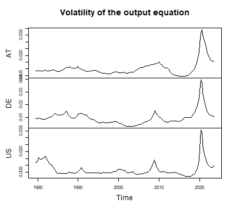
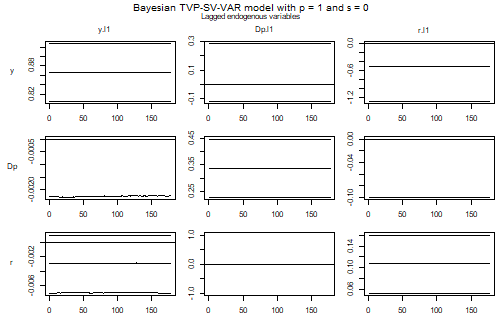
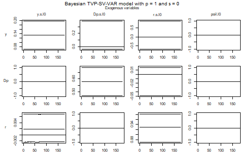
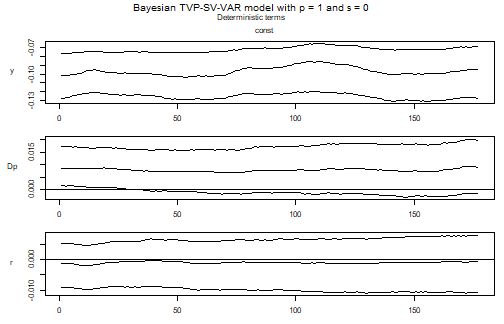
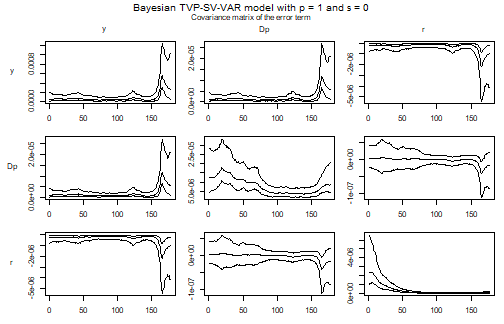
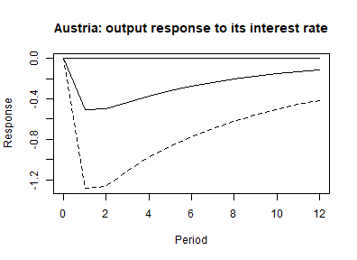
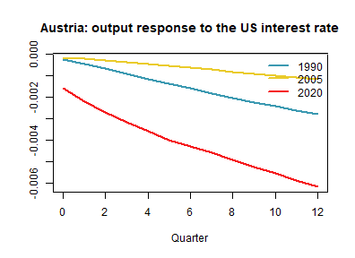

## Introduction

A GVAR sub-model is a VARX\* model: the endogenous variables of one country,
its weakly exogenous foreign variables, and the global variables. `bgvars`
hands that model to the samplers of `bvartools`, so the arguments that make a
VAR time varying make a sub-model time varying in the same way. `tvp = TRUE`
turns the coefficients into random walks, `error = "sv+covar"` turns the error
covariance matrix into a stochastic volatility process, and `varsel = "bvs"`
adds Bayesian variable selection after Korobilis (2013).

The vignette on time varying parameters and stochastic volatility in
`bvartools` sets out the model equations and what each prior does. This one
covers what is specific to a global model: how the specification is applied to
every sub-model at once, what the sub-models look like afterwards, and -- at
the end -- how a global model is solved from time varying or stochastic
volatility sub-models, which is one period at a time.

The reason for wanting these models on this data set is the sample. It runs to
2023Q3 and therefore contains the global financial crisis and the pandemic, two
episodes in which the size of the shocks that hit real GDP is nothing like the
size of the shocks in the surrounding decades. A sub-model with a constant error
covariance matrix has to average over that.

## Data


``` r
library(bgvars)

data("gvar2023")

global_data <- gvar2023[["global_data"]][, "poil", drop = FALSE]
submodel_data <- select_list_elements(gvar2023[["submodel_data"]],
                                      c("AT", "DE", "US"))
```

Three countries keep the example small. The specification below uses output,
inflation and the short-term interest rate, and leaves the exchange rate out.
That is not only for brevity: the deflated exchange rate `ep` of the US model in
this data set is minus the US price level by construction, so its innovation is
minus the innovation of US inflation, and a US sub-model that contains both has
an exactly singular error covariance matrix. The GVAR literature handles this by
giving the US model a specification of its own, which the vignette on global
vector autoregressive models shows how to do.

## Model set-up


``` r
object <- create_gvarmodel(submodel_data = submodel_data,
                           global_data = global_data)

object <- add_weight_matrices(object,
                              submodel_data = submodel_data,
                              period = 3)
```

`add_submodels` applies one specification to every sub-model, and the time
varying arguments are part of it.


``` r
object <- add_submodels(object,
                        endogen = c("y", "Dp", "r"),
                        p_endogen = 1,
                        exogen = c("y", "Dp", "r"),
                        p_exogen = 1,
                        global = "poil",
                        s = 1,
                        tvp = TRUE,
                        error = "sv+covar",
                        varsel = "bvs",
                        iterations = 2000,
                        burnin = 1000)

object <- align_model_obs(object)

object[["submodels"]][["AT"]][[1]][["model"]][["algorithm"]]
#> [1] "VarTvpStochvol"
```

Every sub-model is estimated by the same sampler, and each gets its own state
equations: its own variances of the coefficient random walks, its own
log-volatilities, and its own inclusion parameters. Nothing about the time
varying part is shared across countries. What ties the sub-models together are
the weight matrices, which turn the endogenous variables of the global model
into the weakly exogenous variables of each sub-model, and those are the same
whether a sub-model is time varying or not.

## Priors, initial values and posterior draws

The prior lists are the ones of the `bvartools` vignette and are passed
unchanged to every sub-model. One value differs, and it is the most important
choice in this vignette.


``` r
object <- add_priors(object,
                     coef = list(v_i = 1, v_i_det = 1 / 10,
                                 shape = 3, rate = 1e-10, rate_det = 1e-8),
                     sigma = list(shape = 3, rate = 0.01,
                                  mu = 0, v_i = 0.01,
                                  state_variance = 0.05, offset = 1e-8),
                     varsel = list(inprior = 0.5, exclude_det = TRUE))

object <- add_initial_values(object)
```

`coef$rate` is the rate of the inverse gamma prior of the variances of the
random walks of the coefficients, and it decides how far a coefficient may move
from one quarter to the next. It is not scale free. The value of `0.0001` that
the `bvartools` vignette uses on series measured in percent is far too loose
here, because the variables of this data set are logarithms, whose regressors
are of order one while the residuals are of order one percent.

The consequence is worth stating plainly, because the model does not complain.
Each of these sub-models has 24 coefficients per period against three
observations per period, so it is saturated: given enough freedom the
coefficient path fits every observation exactly, the residuals collapse to
zero, and the volatility process is left with nothing to explain. At
`coef$rate = 0.0001` that is what happens -- the fitted residuals of the
Austrian output equation have a standard deviation of 0.00004 against 0.012 for
the same regression estimated by least squares. At `1e-8` the collapse is only
partial, but it is still there: the residual standard deviation of the Austrian
output equation is less than two fifths of the least squares one, and that of
the German one less than a fifth. At `1e-10`, the value used here, the
coefficients still move, the fit is close to that of least squares rather than
better than it, and the volatilities do the work they are there for.

The check is worth running on any time varying model with many coefficients and
a short sample: compare the residuals under the posterior mean of the
coefficient path with the residuals of an ordinary least squares fit of the same
regressors. If the first is very much smaller than the second, the coefficients
have absorbed the model.


``` r
object <- add_posterior_coefficients(object)
```

Sub-models are independent of one another given the weight matrices, so this
step parallelises over them, and the cost of the time varying specification is
paid once per country.

## Evaluation

A sub-model is an ordinary model object, so everything the `bvartools` vignette
does with a TVP-SV-VAR applies to it.


``` r
model_at <- object[["submodels"]][["AT"]][[1]]

summary(model_at)
#> 
#> Bayesian TVP-SV-VAR model with p = 1 and s = 0 
#> 
#> Variable selection algorithm: Bayesian variable selection (Korobilis, 2013)
#> 
#> Endogenous variables: y, Dp, r
#> 
#> Period: 177 
#> 
#> Variable: y 
#> 
#>                 Mean         SD     Naive SD Time-series SD        2.5%
#> y.l1     0.867576924 0.03047407 0.0006814210    0.001231476  0.80507941
#> Dp.l1    0.015458400 0.08371826 0.0018719971    0.003305019 -0.11798568
#> r.l1    -0.495378613 0.35749325 0.0079937920    0.035965864 -1.28747829
#> y.s.l0   0.133586866 0.03308863 0.0007398843    0.001269837  0.06946605
#> Dp.s.l0  0.038574947 0.10716050 0.0023961816    0.005375287 -0.03250010
#> r.s.l0   0.029376670 0.34823902 0.0077868611    0.028617867 -0.67787202
#> poil.l0  0.000000000 0.00000000 0.0000000000    0.000000000  0.00000000
#> const    0.001982722 0.03361837 0.0007517297    0.001746450 -0.06858804
#>                  50%      97.5% Incl. prob.  
#> y.l1     0.867100618 0.92771338      1.0000 *
#> Dp.l1    0.000000000 0.28706795      0.1635  
#> r.l1    -0.503812037 0.00000000      0.8235  
#> y.s.l0   0.133286601 0.19891986      1.0000 *
#> Dp.s.l0  0.000000000 0.38326497      0.2205  
#> r.s.l0   0.000000000 0.88244074      0.4915  
#> poil.l0  0.000000000 0.00000000      0.0000  
#> const    0.002773653 0.06697577      1.0000  
#> 
#> Variable: Dp 
#> 
#>                  Mean           SD     Naive SD Time-series SD          2.5%
#> y.l1    -0.0001035956 0.0007973551 1.782940e-05   7.744098e-05 -2.253164e-03
#> Dp.l1    0.3372309977 0.0562659830 1.258146e-03   1.853541e-03  2.264534e-01
#> r.l1    -0.0078508486 0.0439652851 9.830937e-04   2.498707e-03 -1.002047e-01
#> y.s.l0   0.0000000000 0.0000000000 0.000000e+00   0.000000e+00  0.000000e+00
#> Dp.s.l0  0.5792248915 0.0546860533 1.222817e-03   2.357085e-03  4.705249e-01
#> r.s.l0   0.0012906427 0.0417170127 9.328208e-04   1.810434e-03 -4.900551e-02
#> poil.l0  0.0000000000 0.0000000000 0.000000e+00   0.000000e+00  0.000000e+00
#> const    0.0017855258 0.0039601958 8.855267e-05   3.933268e-04  4.963748e-05
#>                 50%      97.5% Incl. prob.  
#> y.l1    0.000000000 0.00000000      0.0675  
#> Dp.l1   0.337997327 0.44808609      1.0000 *
#> r.l1    0.000000000 0.00000000      0.1050  
#> y.s.l0  0.000000000 0.00000000      0.0000  
#> Dp.s.l0 0.578832678 0.68787381      1.0000 *
#> r.s.l0  0.000000000 0.01543667      0.0730  
#> poil.l0 0.000000000 0.00000000      0.0000  
#> const   0.001238429 0.01209314      1.0000 *
#> 
#> Variable: r 
#> 
#>                  Mean           SD     Naive SD Time-series SD         2.5%
#> y.l1    -2.911670e-03 0.0020645207 4.616409e-05   1.407952e-04 -0.007029694
#> Dp.l1    2.005861e-04 0.0016908597 3.780877e-05   8.256999e-05  0.000000000
#> r.l1     1.073545e-01 0.0278156028 6.219758e-04   1.133205e-03  0.052949956
#> y.s.l0   1.985658e-03 0.0022981615 5.138845e-05   1.643584e-04 -0.002298910
#> Dp.s.l0  7.830072e-06 0.0002409947 5.388805e-06   7.693076e-06  0.000000000
#> r.s.l0   9.277886e-01 0.0293062968 6.553087e-04   1.132092e-03  0.870435451
#> poil.l0  0.000000e+00 0.0000000000 0.000000e+00   0.000000e+00  0.000000000
#> const    4.139193e-03 0.0060354010 1.349557e-04   2.145110e-04 -0.007665008
#>                  50%        97.5% Incl. prob.  
#> y.l1    -0.002887190 0.0009269967      1.0000  
#> Dp.l1    0.000000000 0.0000000000      0.0260  
#> r.l1     0.107285589 0.1600025317      1.0000 *
#> y.s.l0   0.001865720 0.0068556455      1.0000  
#> Dp.s.l0  0.000000000 0.0000000000      0.0015  
#> r.s.l0   0.928513935 0.9818610414      1.0000 *
#> poil.l0  0.000000000 0.0000000000      0.0000  
#> const    0.004246615 0.0157847179      1.0000  
#> 
#> Variance-covariance matrix:
#> 
#>                Mean           SD     Naive SD Time-series SD          2.5%
#> y_y    2.752465e-04 3.445666e-04 7.704744e-06   2.373456e-05  2.857315e-05
#> y_Dp   7.949345e-06 1.331741e-05 2.977863e-07   6.129914e-07 -7.745685e-07
#> y_r   -6.212831e-07 1.057004e-06 2.363532e-08   5.375978e-08 -3.307212e-06
#> Dp_Dp  1.390677e-05 8.491306e-06 1.898714e-07   7.871415e-07  5.307146e-06
#> Dp_r  -2.725132e-08 1.247856e-07 2.790292e-09   4.066581e-09 -2.893914e-07
#> r_r    3.050558e-08 1.875003e-08 4.192634e-10   1.107879e-09  9.739711e-09
#>                 50%        97.5%  
#> y_y    1.713600e-04 1.103664e-03 *
#> y_Dp   4.227225e-06 4.088267e-05  
#> y_r   -3.423315e-07 3.072267e-07  
#> Dp_Dp  1.182780e-05 3.645523e-05 *
#> Dp_r  -2.654673e-08 2.243553e-07  
#> r_r    2.622480e-08 7.669769e-08 *
```

The table describes the last period of the estimation sample; argument `period`
asks for another one. The regressors ending in `.s` are the weakly exogenous
foreign variables that the weight matrices produced.

### Volatility across countries

The figure that justifies the specification is the volatility of the output
equation, which the following extracts for each sub-model in turn.


``` r
volatility <- function(object, variable) {
  k <- object[["model"]][["k"]]
  kk <- k * k
  tt <- nrow(object[["data"]][["train"]][["y"]])
  draws <- object[["posterior"]][["u_sigma_inv"]][["coeffs"]]
  i <- which(object[["model"]][["endogen"]] == variable)

  result <- rep(NA_real_, tt)
  for (period in 1:tt) {
    result[period] <- mean(apply(draws[, (period - 1) * kk + 1:kk], 1,
                                 function(x, k, i) {
                                   sqrt(solve(matrix(x, k))[i, i])
                                 }, k = k, i = i))
  }

  stats::ts(result, start = stats::start(object[["data"]][["train"]][["y"]]),
            frequency = stats::frequency(object[["data"]][["train"]][["y"]]))
}

paths <- sapply(object[["submodels"]], function(x) {volatility(x[[1]], "y")})
paths <- stats::ts(paths,
                   start = stats::start(model_at[["data"]][["train"]][["y"]]),
                   frequency = 4)

plot(paths, main = "Volatility of the output equation")
```

<div class="figure" style="text-align: center">

<p class="caption">plot of chunk volatility</p>
</div>

Each country gets its own path. This is what a constant error covariance matrix
cannot represent: it would have to choose a single number for a sample in which
the size of an output shock differs by a large factor between the quiet years
and 2020.

The residual check of the previous section belongs beside this figure, since the
two are the same question asked twice. A volatility path that is a flat line is
rarely a finding about the data; it usually means the coefficients were allowed
to move enough to leave no residual behind.


``` r
residual_sd <- function(object) {
  k <- object[["model"]][["k"]]
  m <- ncol(object[["data"]][["train"]][["z"]])
  tt <- nrow(object[["data"]][["train"]][["y"]])
  y <- matrix(t(object[["data"]][["train"]][["y"]]))
  z <- object[["data"]][["train"]][["z"]]

  a <- colMeans(object[["posterior"]][["a"]][["coeffs"]])
  fitted <- rep(NA_real_, tt * k)
  for (period in 1:tt) {
    rows <- (period - 1) * k + 1:k
    fitted[rows] <- z[rows, ] %*% a[(period - 1) * m + 1:m]
  }

  ols <- solve(crossprod(z)) %*% crossprod(z, y)

  result <- rbind(apply(matrix(y - fitted, k), 1, stats::sd),
                  apply(matrix(y - z %*% ols, k), 1, stats::sd))
  dimnames(result) <- list(c("tvp", "ls"), object[["model"]][["endogen"]])
  result
}

round(residual_sd(model_at), 5)
#>           y      Dp       r
#> tvp 0.01395 0.00308 0.00082
#> ls  0.01223 0.00299 0.00084
```

### Coefficient paths


``` r
plot(model_at)
```

<div class="figure" style="text-align: center">

<p class="caption">plot of chunk paths</p>
</div><div class="figure" style="text-align: center">

<p class="caption">plot of chunk paths</p>
</div><div class="figure" style="text-align: center">

<p class="caption">plot of chunk paths</p>
</div><div class="figure" style="text-align: center">

<p class="caption">plot of chunk paths</p>
</div>

`plot` draws one figure per block of coefficients rather than one figure for the
whole model, which for a sub-model of this size is the difference between panels
that can be read and panels that cannot. A panel resting on a flat line at zero
is a coefficient that variable selection switched off. Since one inclusion
parameter is drawn per coefficient rather than per coefficient and period, a
regressor is either in a sub-model over the whole sample or out of it over the
whole sample, and the inclusion probabilities therefore differ across countries
but not across periods.

The coefficient paths of this specification are practically flat, and the
columns of $\Sigma_t$ beside them are not. That is the other side of the
prior discussed above and it is worth reading as a result rather than as a
disappointment: for these series most of what changes over four decades is the
size of the shocks, not the transmission, which is the usual finding for
macroeconomic data and the reason the constant coefficient model with stochastic
volatility is hard to beat.


``` r
inclusion <- function(object) {
  k <- object[["model"]][["k"]]
  matrix(round(colMeans(object[["posterior"]][["a"]][["lambda"]]), 2), k,
         dimnames = list(object[["model"]][["endogen"]],
                         dimnames(object[["data"]][["train"]][["x"]])[[2]]))
}

lapply(object[["submodels"]], function(x) {inclusion(x[[1]])})
#> $AT
#>    y.l1 Dp.l1 r.l1 y.s.l0 Dp.s.l0 r.s.l0 poil.l0 const
#> y  1.00  0.16 0.82      1    0.22   0.49       0     1
#> Dp 0.07  1.00 0.10      0    1.00   0.07       0     1
#> r  1.00  0.03 1.00      1    0.00   1.00       0     1
#> 
#> $DE
#>    y.l1 Dp.l1 r.l1 y.s.l0 Dp.s.l0 r.s.l0 poil.l0 const
#> y     1  0.17    1      0    0.17   0.99       0     1
#> Dp    1  0.41    1      0    1.00   0.07       0     1
#> r     1  0.19    1      1    0.03   1.00       0     1
#> 
#> $US
#>    y.l1 Dp.l1 r.l1 y.s.l0 Dp.s.l0 r.s.l0 poil.l0 const
#> y     1  0.12 0.14      0    0.24   0.56       0     1
#> Dp    0  1.00 0.72      0    1.00   0.19       0     1
#> r     1  0.05 1.00      1    0.02   0.25       0     1
```

### Impulse responses of a sub-model


``` r
period_of <- function(object, year, quarter) {
  which(stats::time(object[["data"]][["train"]][["y"]]) == year + (quarter - 1) / 4)
}

response <- irf(model_at, impulse = "r", response = "y", n_ahead = 12,
                period = period_of(model_at, 2005, 1))

plot(response, main = "Austria: output response to its interest rate")
```

<div class="figure" style="text-align: center">

<p class="caption">plot of chunk irf</p>
</div>

These are the dynamics of one sub-model with its foreign variables held fixed,
which is not the same thing as a generalised impulse response of the global
model: the latter lets a shock travel through the weight matrices and come back.
That is the step the next section is about.

## Solving the global model period by period

`submodels_to_gvar` stacks the sub-models and solves the result for its reduced
form. With time varying sub-models, stacking gives
$G_t y_t = A_{1,t} y_{t-1} + \dots + u_t$, in which every matrix and the
covariance matrix of $u_t$ belong to a period, so the reduced form needs
$G_t^{-1}$ for every period of every draw. What comes out of that is not one
global model but one per period: for this example 176 of them, each held in
2000 draws.

`submodels_to_gvar` does not produce all of them at once. Argument `period`
names the period, and only the draws of that period are taken from each
sub-model -- its coefficients and its error covariance matrix -- before they are
stacked and solved. Nothing of the other periods is collected or stored. The
result is an ordinary global model with constant coefficients that describes
the economy at that date, and everything the vignette on global vector
autoregressive models does with a solved model applies to it. A model for
another date takes another call.

`period` counts the periods of the global data, not those of a sub-model, so a
date is mapped onto it through the time index of the global data. The same
period also selects the weight matrices, which in this example are calculated
from a rolling window of three years of trade and so move over time as well.


``` r
times <- stats::time(object[["global"]][["endogen"]])
dates <- c(1990, 2005, 2020)
periods <- sapply(dates, function(x) {which.min(abs(times - x))})

gvar <- lapply(periods, function(x) {submodels_to_gvar(object, period = x)})
names(gvar) <- dates
```

Each element is a global model of its own, and the three differ in their
contemporaneous matrices, their coefficients and their error covariance
matrices.


``` r
sapply(gvar, function(x) {x[["model"]][["k"]]})
#> 1990 2005 2020 
#>    9    9    9
```

The coefficients and volatilities of a sub-model exist only for its estimation
sample, which starts later than the global data because the lags need
observations of their own. A period before that is refused rather than filled
in:


``` r
submodels_to_gvar(object, period = 1)
#> Error in `.submodel_at_period()`:
#> ! Sub-model AT has time varying parameters or stochastic volatility, which are only available for its estimation sample from 1979.5 to 2023.5, so the model cannot be solved at 1979.25.
```

### Generalised impulse responses at different dates

Generalised impulse responses are then obtained for each solved model in turn.


``` r
girf <- lapply(gvar, irf, impulse = "US_r", response = "AT_y",
               n_ahead = 12, type = "gir", shock = "sd")

medians <- sapply(girf, function(x) {x[, 2]})
matplot(0:12, medians, type = "l", lty = 1, lwd = 2,
        col = grDevices::hcl.colors(length(dates), "Zissou 1"),
        xlab = "Quarter", ylab = "",
        main = "Austria: output response to the US interest rate")
abline(h = 0, col = "grey")
legend("topright", legend = dates, lty = 1, lwd = 2, bty = "n",
       col = grDevices::hcl.colors(length(dates), "Zissou 1"))
```

<div class="figure" style="text-align: center">

<p class="caption">plot of chunk girf</p>
</div>

The figure shows the posterior medians; `plot(girf[["2005"]])` draws one of
them with its credible band. Two things change between the lines, and they
should be kept apart when reading them. `shock = "sd"` scales the shock to one
standard deviation of the US interest rate residual *in that period*, and under
stochastic volatility that standard deviation is itself a function of the date.
A difference between the lines is therefore partly a difference in the size of
the shock and only partly a difference in how it is transmitted -- through the
coefficients of the sub-models and through the weight matrices of that period.
A shock of fixed size, given as a number in `shock`, isolates the second part.

Estimating the sub-models outside R changes nothing about this.
`write_to_hdf5` exports time varying and stochastic volatility sub-models like
any other, BayesTS estimates them, `choose_best_model_from_hdf5` ranks them, by
WAIC or LOOIC, against each other and against constant coefficient sub-models,
and `read_gvar_from_folder` brings them back to be solved period by period in
the same way.

## References

Chudik, A., & Pesaran, M. H. (2016). Theory and practice of GVAR modelling. *Journal of Economic Surveys 30*(1), 165-197. <https://doi.org/10.1111/joes.12095>

Korobilis, D. (2013). VAR forecasting using Bayesian variable selection. *Journal of Applied Econometrics, 28*(2), 204-230. <https://doi.org/10.1002/jae.1271>

Mohaddes, K., & Raissi, M. (2024). *Compilation, revision and updating of the global VAR (GVAR) database, 1979Q2--2023Q3* (mimeo). University of Cambridge: Judge Business School. <https://www.mohaddes.org/gvar>

Pesaran, M. H., Schuermann, T., & Weiner, S. M. (2004). Modeling regional interdependencies using a global error-correcting macroeconometric model. *Journal of Business & Economic Statistics 22*(2), 129-162. <https://doi.org/10.1198/073500104000000019>

Primiceri, G. E. (2005). Time varying structural vector autoregressions and monetary policy. *Review of Economic Studies, 72*(3), 821-852. <https://doi.org/10.1111/j.1467-937X.2005.00353.x>
