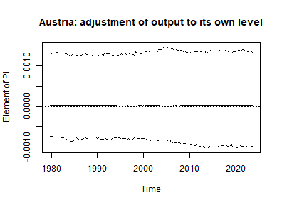
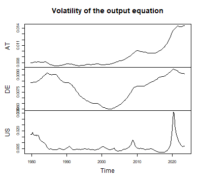
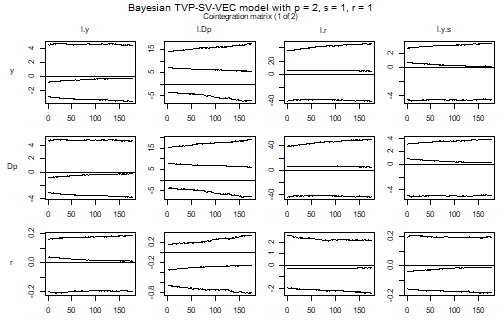
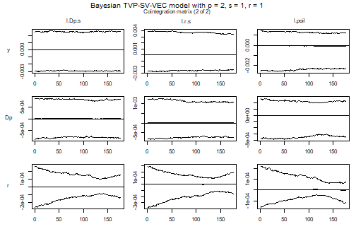
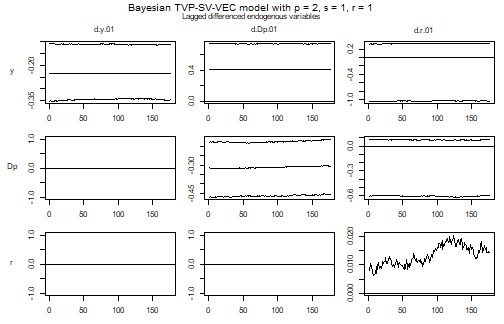
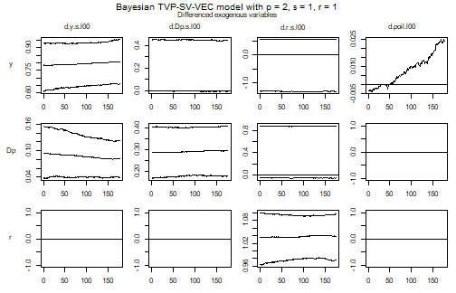
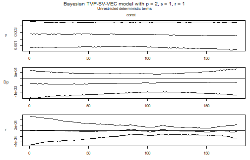
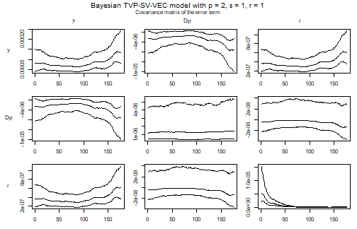
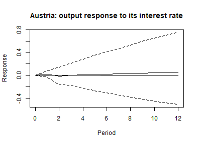
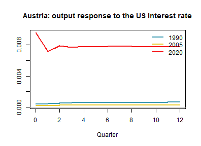

## Introduction

The companion vignette on time varying parameters and stochastic volatility in
GVAR sub-models describes what `tvp`, `error` and `varsel` do, and why the prior
on the variances of the coefficient random walks is the choice that matters most
in a sub-model. This one covers the error correction case, where the same three
arguments reach one block more: the cointegration term.

A GVEC sub-model is a VECX\* model,

$$\Delta y_{it} = \Pi_{i,t} w_{it} + \sum_{l=1}^{p-1} \Gamma_{il,t} \Delta y_{i,t-l}
+ \sum_{l=0}^{q-1} \Upsilon_{il,t} \Delta x_{i,t-l} + C_{i,t} d_t + u_{it},$$

with $\Pi_{i,t} = \alpha_{i,t} \beta_{i,t}^{\prime}$ of rank $r_i$, where
$w_{it}$ collects the levels of the country's own variables, of its weakly
exogenous foreign variables and of the global variables. With `tvp = TRUE` the
loadings and the coefficients of the differenced regressors follow random walks
and the cointegration vectors get a state equation of their own,

$$\beta_{i,t} = \rho \beta_{i,t-1} + \eta_{it}, \qquad \eta_{it} \sim N(0, I),$$

after Koop, León-González and Strachan (2011). The long-run relationship of each
country is therefore allowed to move, which is the question these models are for
and the one thing a GVAR sub-model cannot ask.

## Data


``` r
library(bgvars)

data("gvar2023")

global_data <- gvar2023[["global_data"]][, "poil", drop = FALSE]
submodel_data <- select_list_elements(gvar2023[["submodel_data"]],
                                      c("AT", "DE", "US"))
```

Three countries, output, inflation and the short-term interest rate, as in the
GVAR vignette and for the same reasons: the example stays small, and the
deflated exchange rate of the US model in this data set is minus the US price
level by construction, so a sub-model containing both it and inflation has an
exactly singular error covariance matrix.

## Model set-up


``` r
object <- create_gvecmodel(submodel_data = submodel_data,
                           global_data = global_data)

object <- add_weight_matrices(object,
                              submodel_data = submodel_data,
                              period = 3)
```


``` r
object <- add_submodels(object,
                        endogen = c("y", "Dp", "r"),
                        p_endogen = 2,
                        exogen = c("y", "Dp", "r"),
                        p_exogen = 2,
                        global = "poil",
                        s = 2,
                        r = 1,
                        const = "unrestricted",
                        tvp = TRUE,
                        error = "sv+covar",
                        varsel = "bvs",
                        iterations = 2000,
                        burnin = 1000)

object <- align_model_obs(object)

object[["submodels"]][["AT"]][[1]][["model"]][["algorithm"]]
#> [1] "VecTvpStochvol"
```

`p_endogen` is the lag order of the level VAR, so each sub-model contains
$p - 1 = 1$ lag of the differenced endogenous variables. The error correction
term holds the levels of everything the sub-model sees:


``` r
model_at <- object[["submodels"]][["AT"]][[1]]

dimnames(model_at[["data"]][["train"]][["w"]])[[2]]
#> [1] "l.y"    "l.Dp"   "l.r"    "l.y.s"  "l.Dp.s" "l.r.s"  "l.poil"
```

The first three are Austria's own variables, the next three the weakly exogenous
foreign variables that the weight matrices produced, and the last the oil price.
A cointegration rank of one says that the seven of them are tied together by a
single long-run relationship.

## Priors


``` r
object <- add_priors(object,
                     coef = list(v_i = 1, v_i_det = 1 / 10, shape = 3,
                                 rate = 1e-5, rate_alpha = 1e-10, rate_det = 1e-8),
                     coint = list(rho = 0.999),
                     sigma = list(shape = 3, rate = 0.01,
                                  mu = 0, v_i = 0.01,
                                  state_variance = 0.05, offset = 1e-8),
                     varsel = list(inprior = 0.5, exclude_det = TRUE))

object <- add_initial_values(object)
```

`coef` sets the prior on the variances of the coefficient random walks, and an
error correction sub-model needs three of them. `rate` is the one of the
coefficients of the differenced regressors. `rate_alpha` is the one of the
loadings: the series in the error correction term are levels, so a drift in a
loading that would be negligible for a coefficient on a differenced regressor
moves the fitted value by far more. `rate_det` is the one of the unrestricted
constant, which shifts every fitted value of its equation directly. With a shape
of 3 the prior mean of an innovation variance is half the rate, so these values
let the coefficients of the differenced regressors move by a standard deviation
of about 0.002 a quarter, and hold the loadings (about 7e-6) and the constant
(about 7e-5) nearly still.

A single rate cannot do both. One small enough for the loadings freezes every
other coefficient as well, and the sub-model is then a constant coefficient model
with stochastic volatility in all but name. One large enough for the other
coefficients lets the loadings, and with a large `rate_det` the constant, fit the
residuals away. Whether the rates are right shows in two diagnostics after the
posterior draws below: the residuals, and how far the coefficient paths move.

`coint` is what an error correction model adds. For a time varying sub-model it
takes `rho`, the autocorrelation of the state equation of $\beta$, and not the
`v_i` and `p_tau_i` of the cointegration space prior, which a constant
coefficient sub-model takes instead. `rho` must be smaller than one: the prior
on the state before the sample is the stationary distribution of that equation,
$N(0, I / (1 - \rho^2))$, and it is what makes the prior proper, so a value close
to one is intended and one far from it draws a warning. Since only the product
$\alpha_t \beta_t^{\prime}$ is identified, the prior variance of the loadings is
shrunk by $1 - \rho^2$ to compensate, which leaves the product on the scale that
`coef$v_i` asks for.

Variable selection never reaches the loadings. They are the first $K r$
coefficients of a sub-model and are dropped from the selection, because the
cointegration term is drawn in a step of its own, so the columns of $\Pi$ are
always in the model whatever `inprior` says. `exclude_det = TRUE` keeps the
unrestricted constant out of the selection as well, which leaves the
coefficients of the differenced regressors as the only ones being selected over.

## Posterior draws


``` r
set.seed(20260913)
object <- add_posterior_coefficients(object)
```

The draws are made on the scale of the data. `scale_error_correction` and
`rescale_error_correction` could divide the series in the error correction term
by the standard deviation of their differences before simulating and put them
back afterwards, and for a sub-model with constant coefficients that is a
reasonable, deliberate step. With time varying coefficients it is a risky one.
Scaling makes the levels in the error correction term large relative to the
residuals, so a small drift in a loading moves the fitted value by a lot, and the
coefficient paths can absorb the residuals of an equation almost entirely, which
leaves its volatility far below that of a least squares fit and nearly flat over
the sample. In the bvartools vignette on TVP-SV-VEC models a scaled error
correction term did that to the short-term interest rate equation in each of four
chains, where the unscaled one did not. Unscaled series and small rates for the
loadings and the constant are the safer combination.

Whatever the choice, the residuals are the check. The posterior standard
deviation of the errors of each equation, averaged over the sample, should be of
the order of that of a least squares fit of the same regressors, not a fraction
of it:


``` r
residual_sd <- function(object) {
  y <- object[["data"]][["train"]][["y"]]
  d <- cbind(object[["data"]][["train"]][["w"]], object[["data"]][["train"]][["x"]])
  ls <- y - d %*% solve(crossprod(d), crossprod(d, y))

  k <- object[["model"]][["k"]]
  kk <- k * k
  tt <- nrow(y)
  draws <- object[["posterior"]][["u_sigma_inv"]][["coeffs"]]
  draws <- draws[seq(1, nrow(draws), by = 10), , drop = FALSE]

  # Posterior mean of the error variance of each equation, period by period.
  variance <- matrix(NA_real_, tt, k)
  for (period in 1:tt) {
    variance[period, ] <- rowMeans(apply(draws[, (period - 1) * kk + 1:kk, drop = FALSE], 1,
                                         function(x) {diag(solve(matrix(x, k)))}))
  }

  round(rbind("least squares" = apply(ls, 2, stats::sd),
              "posterior" = sqrt(colMeans(variance))), 4)
}

lapply(object[["submodels"]], function(x) {residual_sd(x[[1]])})
#> $AT
#>                  d.y   d.Dp   d.r
#> least squares 0.0087 0.0027 7e-04
#> posterior     0.0094 0.0034 8e-04
#> 
#> $DE
#>                  d.y   d.Dp   d.r
#> least squares 0.0079 0.0030 8e-04
#> posterior     0.0081 0.0037 8e-04
#> 
#> $US
#>                  d.y   d.Dp    d.r
#> least squares 0.0070 0.0035 0.0014
#> posterior     0.0087 0.0042 0.0017
```

Every equation passes. The posterior standard deviations are of the order of the
least squares ones, from about equal to them to about a third above, which is
what a prior that lets the coefficients drift slowly and selects some of them out
of the model should give: the posterior fit cannot be better than an
unrestricted regression on the same regressors, and it is allowed to be a little
worse. A single chain that passes the check does not rule out another seed that
fails it, so for a model that is to be used rather than illustrated, the
comparison is worth repeating across chains.

Passing the residual check says that the coefficients do not vary too much, not
that they vary at all: a prior that freezes them passes it just as well. How far
they move is the other half of the check. For each block of coefficients, the
function below takes the range of each posterior mean path over the sample, in
posterior standard deviations of the last period, and gives the median and the
largest of them over the coefficients that variable selection keeps:


``` r
drift <- function(object) {
  k <- object[["model"]][["k_endogen"]]
  n_a <- ncol(object[["data"]][["train"]][["z"]])
  tt <- nrow(object[["data"]][["train"]][["y"]])
  n_alpha <- k * object[["model"]][["rank"]]
  n_det <- k * object[["model"]][["n"]]
  draws <- object[["posterior"]][["a"]][["coeffs"]]

  # Posterior mean of every coefficient, one column per period
  path <- matrix(colMeans(draws), n_a)
  sd_last <- apply(draws[, (tt - 1) * n_a + 1:n_a, drop = FALSE], 2, stats::sd)
  moved <- (apply(path, 1, max) - apply(path, 1, min)) / sd_last

  block <- rep("short run", n_a)
  block[seq_len(n_alpha)] <- "loadings"
  block[n_a - n_det + seq_len(n_det)] <- "constant"
  kept <- colMeans(object[["posterior"]][["a"]][["lambda"]]) >= 0.5 & sd_last > 0

  result <- NULL
  for (b in c("loadings", "short run", "constant")) {
    result[paste(b, "median")] <- stats::median(moved[kept & block == b])
    result[paste(b, "largest")] <- max(moved[kept & block == b])
  }
  round(result, 2)
}

sapply(object[["submodels"]], function(x) {drift(x[[1]])})
#>                     AT   DE   US
#> loadings median   0.12 0.13 0.51
#> loadings largest  0.17 0.39 0.56
#> short run median  0.15 0.08 0.04
#> short run largest 0.55 2.88 2.60
#> constant median   0.42 0.16 0.31
#> constant largest  0.85 0.93 1.91
```

Every block moves. The short-run coefficients that stay in the model drift by a
median of 0.04 (US) to 0.15 (AT) posterior standard deviations over the sample,
and the largest of them by 0.55 in Austria and by close to three in Germany and
the United States. The loadings and the constant, on their much smaller rates,
move by fractions of a standard deviation, the US constant by almost two. With
one rate of 1e-12 for all coefficients, small enough for the loadings, the
short-run medians round to 0.00 in all three sub-models.

## Evaluation

### Summary statistics for a period


``` r
model_at <- object[["submodels"]][["AT"]][[1]]

summary(model_at)
#> 
#> Bayesian TVP-SV-VEC model with p = 2 and s = 1 
#> 
#> Variable selection algorithm: Bayesian variable selection (Korobilis, 2013)
#> 
#> Endogenous variables: y, Dp, r
#> 
#> Period: 176 
#> 
#> Variable: y 
#> 
#>                    Mean          SD     Naive SD Time-series SD          2.5%
#> l.y        9.684068e-05 0.001380687 3.087309e-05   5.771737e-05 -0.0026150020
#> l.Dp      -3.125677e-04 0.002059332 4.604806e-05   1.121220e-04 -0.0052872057
#> l.r       -4.024226e-04 0.002726890 6.097512e-05   1.497807e-04 -0.0069037204
#> l.y.s     -4.793464e-05 0.001334969 2.985082e-05   7.485878e-05 -0.0029352125
#> l.Dp.s     1.968993e-04 0.002510155 5.612877e-05   1.479147e-04 -0.0050052175
#> l.r.s      7.698555e-05 0.002893045 6.469045e-05   2.529798e-04 -0.0058745451
#> l.poil    -1.667358e-04 0.001283359 2.869678e-05   4.806731e-05 -0.0032558493
#> d.y.01    -2.323207e-01 0.061670273 1.378989e-03   2.934467e-03 -0.3465759784
#> d.Dp.01    3.799192e-01 0.205137024 4.587003e-03   8.897416e-03  0.0000000000
#> d.r.01    -1.277476e-01 0.321540534 7.189865e-03   8.097991e-03 -1.0283265949
#> d.y.s.00   7.968540e-01 0.072284495 1.616330e-03   3.102234e-03  0.6518446967
#> d.Dp.s.00  6.702639e-02 0.130701270 2.922569e-03   5.014038e-03 -0.0067462376
#> d.r.s.00  -1.452428e-01 0.396601187 8.868272e-03   1.082609e-02 -1.2333814123
#> d.poil.00  3.640141e-04 0.003503029 7.833011e-05   2.392649e-04  0.0000000000
#> const      2.505228e-03 0.001048822 2.345237e-05   3.314158e-05  0.0004656687
#>                     50%        97.5% Incl. prob.  
#> l.y        1.684628e-05  0.003340568      1.0000  
#> l.Dp      -8.087093e-05  0.003468826      1.0000  
#> l.r       -8.882635e-05  0.004980135      1.0000  
#> l.y.s     -3.699698e-06  0.002460391      1.0000  
#> l.Dp.s     7.036510e-05  0.005774565      1.0000  
#> l.r.s     -7.966688e-06  0.006892388      1.0000  
#> l.poil    -5.482924e-05  0.002353175      1.0000  
#> d.y.01    -2.339322e-01 -0.110574319      0.9890 *
#> d.Dp.01    4.038621e-01  0.742305614      0.8755  
#> d.r.01     0.000000e+00  0.328584650      0.3790  
#> d.y.s.00   7.980882e-01  0.932454907      1.0000 *
#> d.Dp.s.00  0.000000e+00  0.422090962      0.3125  
#> d.r.s.00   0.000000e+00  0.496787422      0.4125  
#> d.poil.00  0.000000e+00  0.000000000      0.0145  
#> const      2.478273e-03  0.004651475      1.0000 *
#> 
#> Variable: Dp 
#> 
#>                    Mean           SD     Naive SD Time-series SD         2.5%
#> l.y        3.948382e-07 0.0010688224 2.389960e-05   7.299140e-05 -0.002422746
#> l.Dp      -1.561722e-04 0.0013986200 3.127409e-05   6.685867e-05 -0.003109826
#> l.r       -2.136298e-04 0.0018370797 4.107835e-05   1.066771e-04 -0.004330086
#> l.y.s     -1.148116e-04 0.0008881839 1.986040e-05   4.554934e-05 -0.002443767
#> l.Dp.s     1.842014e-04 0.0018167298 4.062331e-05   1.421793e-04 -0.003304676
#> l.r.s      1.256031e-04 0.0019259238 4.306497e-05   1.249702e-04 -0.003990949
#> l.poil    -3.793637e-05 0.0009971999 2.229807e-05   6.640843e-05 -0.002101551
#> d.y.01     1.748010e-04 0.0030183667 6.749273e-05   8.033440e-05  0.000000000
#> d.Dp.01   -3.065575e-01 0.0734340349 1.642035e-03   2.600419e-03 -0.456484229
#> d.r.01    -8.271398e-02 0.1839847459 4.114024e-03   6.362032e-03 -0.600715486
#> d.y.s.00   7.871498e-02 0.0250807998 5.608237e-04   1.979561e-03  0.000000000
#> d.Dp.s.00  2.964190e-01 0.0619241242 1.384666e-03   1.897052e-03  0.173987004
#> d.r.s.00   1.682748e-01 0.2959063778 6.616668e-03   1.875470e-02 -0.091988196
#> d.poil.00  0.000000e+00 0.0000000000 0.000000e+00   0.000000e+00  0.000000000
#> const     -2.216659e-04 0.0005184441 1.159276e-05   1.695660e-05 -0.001276538
#>                     50%         97.5% Incl. prob.  
#> l.y        1.126153e-05  0.0021606276      1.0000  
#> l.Dp      -4.697062e-05  0.0025242262      1.0000  
#> l.r       -8.556700e-05  0.0037123155      1.0000  
#> l.y.s     -1.858513e-05  0.0016406194      1.0000  
#> l.Dp.s     4.730989e-05  0.0045190045      1.0000  
#> l.r.s      4.095954e-05  0.0044839051      1.0000  
#> l.poil    -2.222046e-05  0.0021968429      1.0000  
#> d.y.01     0.000000e+00  0.0000000000      0.0210  
#> d.Dp.01   -3.042774e-01 -0.1646872573      1.0000 *
#> d.r.01     0.000000e+00  0.0814633898      0.3155  
#> d.y.s.00   8.055671e-02  0.1233297149      0.9685  
#> d.Dp.s.00  2.974139e-01  0.4204477139      1.0000 *
#> d.r.s.00   0.000000e+00  0.9649821633      0.4090  
#> d.poil.00  0.000000e+00  0.0000000000      0.0000  
#> const     -2.064209e-04  0.0008147611      1.0000  
#> 
#> Variable: r 
#> 
#>                    Mean           SD     Naive SD Time-series SD          2.5%
#> l.y        6.797941e-06 0.0001239951 2.772615e-06   3.681268e-06 -0.0002527859
#> l.Dp      -3.603060e-06 0.0001859027 4.156910e-06   6.291968e-06 -0.0004147372
#> l.r       -1.074469e-05 0.0002740983 6.129025e-06   1.178830e-05 -0.0006401310
#> l.y.s      1.309003e-05 0.0001142905 2.555614e-06   4.027931e-06 -0.0002133233
#> l.Dp.s    -6.309477e-06 0.0002334362 5.219792e-06   1.024984e-05 -0.0005483558
#> l.r.s      4.486119e-06 0.0002761536 6.174983e-06   1.016172e-05 -0.0006155525
#> l.poil    -1.683734e-05 0.0001166658 2.608726e-06   4.225013e-06 -0.0003017562
#> d.y.01     0.000000e+00 0.0000000000 0.000000e+00   0.000000e+00  0.0000000000
#> d.Dp.01   -1.725418e-05 0.0005498069 1.229406e-05   1.696692e-05  0.0000000000
#> d.r.01     1.245471e-03 0.0085205426 1.905251e-04   4.570722e-04  0.0000000000
#> d.y.s.00   0.000000e+00 0.0000000000 0.000000e+00   0.000000e+00  0.0000000000
#> d.Dp.s.00 -4.248682e-06 0.0003869452 8.652357e-06   3.584985e-06  0.0000000000
#> d.r.s.00   1.037030e+00 0.0319070667 7.134637e-04   8.641842e-04  0.9726967750
#> d.poil.00  0.000000e+00 0.0000000000 0.000000e+00   0.000000e+00  0.0000000000
#> const     -2.933197e-05 0.0001164542 2.603996e-06   3.654601e-06 -0.0002552271
#>                     50%        97.5% Incl. prob.  
#> l.y        1.301175e-06 0.0003085951      1.0000  
#> l.Dp      -1.031429e-06 0.0003998286      1.0000  
#> l.r        1.078868e-07 0.0005630944      1.0000  
#> l.y.s      2.646886e-06 0.0002727292      1.0000  
#> l.Dp.s    -1.514890e-06 0.0004757324      1.0000  
#> l.r.s      3.783965e-07 0.0006060592      1.0000  
#> l.poil    -2.403367e-06 0.0002135221      1.0000  
#> d.y.01     0.000000e+00 0.0000000000      0.0000  
#> d.Dp.01    0.000000e+00 0.0000000000      0.0010  
#> d.r.01     0.000000e+00 0.0231109472      0.0420  
#> d.y.s.00   0.000000e+00 0.0000000000      0.0000  
#> d.Dp.s.00  0.000000e+00 0.0000000000      0.0015  
#> d.r.s.00   1.036730e+00 1.1000671504      1.0000 *
#> d.poil.00  0.000000e+00 0.0000000000      0.0000  
#> const     -3.398674e-05 0.0002133402      1.0000  
#> 
#> Variance-covariance matrix:
#> 
#>                Mean           SD     Naive SD Time-series SD          2.5%
#> y_y    2.161321e-04 9.577042e-05 2.141492e-06   5.870094e-06  1.037133e-04
#> y_Dp   3.105795e-06 7.582451e-06 1.695488e-07   3.035662e-07 -9.774870e-06
#> y_r   -1.667159e-07 1.080513e-06 2.416101e-08   2.884920e-08 -2.454539e-06
#> Dp_Dp  1.618740e-05 7.550041e-06 1.688240e-07   5.475843e-07  6.854698e-06
#> Dp_r  -1.349776e-08 1.731375e-07 3.871472e-09   5.271898e-09 -3.572178e-07
#> r_r    3.504913e-08 1.993173e-08 4.456869e-10   9.132863e-10  1.200788e-08
#>                 50%        97.5%  
#> y_y    1.949926e-04 4.466069e-04 *
#> y_Dp   2.414840e-06 2.016873e-05  
#> y_r   -1.365743e-07 1.936356e-06  
#> Dp_Dp  1.465007e-05 3.624834e-05 *
#> Dp_r  -1.029052e-08 3.270517e-07  
#> r_r    2.994335e-08 8.860499e-08 *
```

The first block of columns is the cointegration matrix $\Pi_t$ rather than
$\alpha_t$ and $\beta_t$ separately, since the factors are identified only up to
an invertible $r \times r$ transformation while their product is not. The table
describes the last period of the sample; argument `period` asks for another one.
The inclusion probabilities of the $\Pi$ columns are one by construction.

### Which regressors the sub-models keep


``` r
inclusion <- function(object) {
  k <- object[["model"]][["k_endogen"]]
  r <- object[["model"]][["rank"]]

  # The draws are vec(A), so one column of this matrix is one regressor. The
  # first r of them are the loadings, which are never selected over.
  result <- matrix(colMeans(object[["posterior"]][["a"]][["lambda"]]), k)
  result <- round(result[, -seq_len(r), drop = FALSE], 2)

  dimnames(result) <- list(object[["model"]][["endogen"]],
                           dimnames(object[["data"]][["train"]][["x"]])[[2]])
  result
}

lapply(object[["submodels"]], function(x) {inclusion(x[[1]])})
#> $AT
#>    d.y.01 d.Dp.01 d.r.01 d.y.s.00 d.Dp.s.00 d.r.s.00 d.poil.00 const
#> y    0.99    0.88   0.38     1.00      0.31     0.41      0.01     1
#> Dp   0.02    1.00   0.32     0.97      1.00     0.41      0.00     1
#> r    0.00    0.00   0.04     0.00      0.00     1.00      0.00     1
#> 
#> $DE
#>    d.y.01 d.Dp.01 d.r.01 d.y.s.00 d.Dp.s.00 d.r.s.00 d.poil.00 const
#> y    0.09    0.11   0.61     1.00      0.13     0.30      0.00     1
#> Dp   0.58    1.00   0.24     0.05      1.00     0.23      0.35     1
#> r    0.00    0.03   1.00     0.00      0.02     1.00      1.00     1
#> 
#> $US
#>    d.y.01 d.Dp.01 d.r.01 d.y.s.00 d.Dp.s.00 d.r.s.00 d.poil.00 const
#> y    0.16    0.06   0.31     0.12      0.18     0.34         0     1
#> Dp   0.03    1.00   0.53     0.04      0.18     0.26         1     1
#> r    0.00    0.01   1.00     0.00      0.01     0.09         0     1
```

One inclusion parameter is drawn per coefficient rather than per coefficient and
period, so a regressor is either in a sub-model over the whole sample or out of
it over the whole sample. The loadings are dropped from the table above because
they are never selected over.

### The long-run relationship over time


``` r
pi_path <- function(object, equation, variable, ci = 0.9) {
  k <- object[["model"]][["k_endogen"]]
  r <- object[["model"]][["rank"]]
  m <- ncol(object[["data"]][["train"]][["z"]])
  k_ect <- ncol(object[["data"]][["train"]][["w"]])
  tt <- nrow(object[["data"]][["train"]][["y"]])
  draws <- nrow(object[["posterior"]][["a"]][["coeffs"]])

  i <- which(object[["model"]][["endogen"]] == equation)
  j <- which(dimnames(object[["data"]][["train"]][["w"]])[[2]] == variable)

  result <- matrix(NA_real_, draws, tt)
  for (period in 1:tt) {
    alpha <- object[["posterior"]][["a"]][["coeffs"]][, (period - 1) * m + 1:(k * r)]
    beta <- object[["posterior"]][["beta"]][["coeffs"]][, (period - 1) * k_ect * r + 1:(k_ect * r)]
    result[, period] <- rowSums(matrix(alpha, draws, k * r)[, k * 0:(r - 1) + i, drop = FALSE] *
                                  matrix(beta, draws, k_ect * r)[, k_ect * 0:(r - 1) + j, drop = FALSE])
  }

  bands <- t(apply(result, 2, stats::quantile,
                   probs = c((1 - ci) / 2, .5, 1 - (1 - ci) / 2)))

  stats::ts(bands, start = stats::start(object[["data"]][["train"]][["y"]]),
            frequency = stats::frequency(object[["data"]][["train"]][["y"]]))
}

path <- pi_path(model_at, equation = "y", variable = "l.y")

stats::ts.plot(path, lty = c(2, 1, 2),
               main = "Austria: adjustment of output to its own level",
               ylab = "Element of Pi")
abline(h = 0, lty = "dotted")
```

<div class="figure" style="text-align: center">

<p class="caption">plot of chunk pi-path</p>
</div>

Only $\Pi_t$ is plotted, not $\beta_t$. A cointegration vector is identified up
to normalisation, and normalising it on a variable whose coefficient wanders near
zero produces a path that swings between large values without anything having
happened to the model. $\Pi_t$ carries the same information and is identified.

### Volatility across countries


``` r
volatility <- function(object, variable) {
  k <- object[["model"]][["k"]]
  kk <- k * k
  tt <- nrow(object[["data"]][["train"]][["y"]])
  draws <- object[["posterior"]][["u_sigma_inv"]][["coeffs"]]
  i <- which(object[["model"]][["endogen"]] == variable)

  result <- rep(NA_real_, tt)
  for (period in 1:tt) {
    result[period] <- mean(apply(draws[, (period - 1) * kk + 1:kk], 1,
                                 function(x, k, i) {
                                   sqrt(solve(matrix(x, k))[i, i])
                                 }, k = k, i = i))
  }

  stats::ts(result, start = stats::start(object[["data"]][["train"]][["y"]]),
            frequency = stats::frequency(object[["data"]][["train"]][["y"]]))
}

paths <- sapply(object[["submodels"]], function(x) {volatility(x[[1]], "y")})
paths <- stats::ts(paths,
                   start = stats::start(model_at[["data"]][["train"]][["y"]]),
                   frequency = 4)

plot(paths, main = "Volatility of the output equation")
```

<div class="figure" style="text-align: center">

<p class="caption">plot of chunk volatility</p>
</div>

The equations are in differences, so these are the volatilities of the shocks to
output growth. The Austrian one rises into the 2020s without spiking, the German
one falls until the early 2000s and recovers, and only the one of the United
States jumps in 2020. The Austrian path is worth dwelling on, because it is not
what the raw data look like: Austrian output fell by ten percent in 2020Q2, six
standard deviations of its own growth rate.

The reason is what a GVAR sub-model is for. The weakly exogenous foreign
variables enter contemporaneously, and the pandemic hit every country in the
same quarter, so the foreign block explains the fall rather than leaving it as an
own-country shock. Dropping that block from the same regression puts it back:


``` r
model_at <- object[["submodels"]][["AT"]][[1]]

y <- model_at[["data"]][["train"]][["y"]]
w <- model_at[["data"]][["train"]][["w"]]
x <- model_at[["data"]][["train"]][["x"]]

ls_residuals <- function(regressors) {
  d <- cbind(w, regressors)
  as.numeric(y[, 1] - d %*% (solve(crossprod(d)) %*% crossprod(d, y[, 1])))
}

foreign <- endsWith(dimnames(x)[[2]], ".s.00")
quarter <- which(stats::time(y) == 2020.25)

data.frame(residual_2020Q2 = c(ls_residuals(x)[quarter],
                               ls_residuals(x[, !foreign, drop = FALSE])[quarter]),
           row.names = c("with the foreign block", "without it"))
#>                        residual_2020Q2
#> with the foreign block     -0.01344996
#> without it                 -0.09304060
```

A global shock is not an own-country shock, and a sub-model says so by leaving it
out of its own error term. What the volatility of a sub-model measures is what is
idiosyncratic to that country once the rest of the world has been conditioned on.

### Coefficient and volatility paths of a sub-model


``` r
plot(model_at)
```

<div class="figure" style="text-align: center">

<p class="caption">plot of chunk paths</p>
</div><div class="figure" style="text-align: center">

<p class="caption">plot of chunk paths</p>
</div><div class="figure" style="text-align: center">

<p class="caption">plot of chunk paths</p>
</div><div class="figure" style="text-align: center">

<p class="caption">plot of chunk paths</p>
</div><div class="figure" style="text-align: center">

<p class="caption">plot of chunk paths</p>
</div><div class="figure" style="text-align: center">

<p class="caption">plot of chunk paths</p>
</div>

Each block of coefficients gets a figure of its own: the cointegration matrix
$\Pi_t$, the lagged differences $\Gamma$, the differenced weakly exogenous and
global variables $\Upsilon$, the unrestricted constant, and the covariance
matrix of the error term. A sub-model with two dozen regressors drawn as one
figure leaves each panel narrower than its own axis labels, which is what this
avoids. A panel at a flat zero among the $\Gamma$ and $\Upsilon$ coefficients is
one that variable selection switched off.

### Impulse responses of a sub-model

Impulse responses are defined for a model in levels, so a sub-model is rewritten
with `vec_to_var` first. For a time varying sub-model the rewriting is done
period by period: the loadings, the cointegration vectors and the coefficients
of each period give the level VARX of that period, and the result holds one
such model per period in the layout of a time varying GVAR sub-model.


``` r
level_at <- vec_to_var(model_at)

period_of <- function(object, year, quarter) {
  which(stats::time(object[["data"]][["train"]][["y"]]) == year + (quarter - 1) / 4)
}

response <- irf(level_at, impulse = "r", response = "y", n_ahead = 12,
                period = period_of(level_at, 2005, 1))

plot(response, main = "Austria: output response to its interest rate")
```

<div class="figure" style="text-align: center">

<p class="caption">plot of chunk irf</p>
</div>

As in the GVAR vignette, these are the dynamics of one sub-model with its
foreign variables held fixed.

## Solving the global model period by period

`submodels_to_gvar` solves a GVEC model by rewriting every sub-model in levels
and stacking the result. With time varying sub-models every period has a global
model of its own, since the loadings, the cointegration vectors, the short-run
coefficients and the error covariance matrices of all sub-models belong to a
period, and so do the contemporaneous matrix $G_t$ and its inverse.

Argument `period` names the period. Only the draws of that period are taken
from each sub-model, and they are taken before the sub-model is rewritten in
levels, so neither the rewriting nor the stacking touches the draws of any other
period. The result is an ordinary global model with constant coefficients that
describes the economy at that date, and a model for another date takes another
call. `period` counts the periods of the global data, and it selects the weight
matrices of that period as well.


``` r
times <- stats::time(object[["global"]][["endogen"]])
dates <- c(1990, 2005, 2020)
periods <- sapply(dates, function(x) {which.min(abs(times - x))})

gvec <- lapply(periods, function(x) {submodels_to_gvar(object, period = x)})
names(gvec) <- dates
```

Each element is a global VAR model in levels:


``` r
sapply(gvec, function(x) {c(k = x[["model"]][["k"]], p = x[["model"]][["p"]])})
#>   1990 2005 2020
#> k    9    9    9
#> p    2    2    2
```

The draws of a sub-model exist only for its estimation sample, which starts
later than the global data because the differences and their lags need
observations of their own. A period before that is refused:


``` r
submodels_to_gvar(object, period = 1)
#> Error in `.submodel_at_period()`:
#> ! Sub-model AT has time varying parameters or stochastic volatility, which are only available for its estimation sample from 1979.75 to 2023.5, so the model cannot be solved at 1979.25.
```

### Generalised impulse responses at different dates


``` r
girf <- lapply(gvec, irf, impulse = "US_r", response = "AT_y",
               n_ahead = 12, type = "gir", shock = "sd")

medians <- sapply(girf, function(x) {x[, 2]})
matplot(0:12, medians, type = "l", lty = 1, lwd = 2,
        col = grDevices::hcl.colors(length(dates), "Zissou 1"),
        xlab = "Quarter", ylab = "",
        main = "Austria: output response to the US interest rate")
abline(h = 0, col = "grey")
legend("topright", legend = dates, lty = 1, lwd = 2, bty = "n",
       col = grDevices::hcl.colors(length(dates), "Zissou 1"))
```

<div class="figure" style="text-align: center">

<p class="caption">plot of chunk girf</p>
</div>

The figure shows the posterior medians; `plot(girf[["2005"]])` draws one of
them with its credible band. The caveat of the GVAR vignette applies here as
well: `shock = "sd"` is one standard deviation of the US interest rate residual
in the period at hand, which under stochastic volatility differs from date to
date, so a difference between the lines mixes the size of the shock with its
transmission. A shock of fixed size, given as a number in `shock`, isolates the
second. The model is in levels, so a response need not return to zero: a shock
to a cointegrated system can move the levels of its variables permanently.

## Choosing between specifications

AIC, BIC and HQ count parameters that a state equation does not use, as
`?bvartools::selection_criteria` explains, so they are no guide for these
sub-models. WAIC and LOOIC are no reliable guide either. `add_posterior_loglik`
evaluates the likelihood of each period at the states of that period, and those
states have seen the period's observation: the state of a period is informed
mostly by the observation it is evaluated at, so leaving that observation out by
reweighting the draws fails for exactly the periods a path bends towards, which
the Pareto k diagnostics of LOOIC report. Neither criterion then separates
specifications that differ in how much freedom their states have, and the
cointegration rank is such a difference.

Koop, León-González and Strachan (2011) choose between their time varying
cointegration models by the log predictive likelihood instead. For every period
of an evaluation sample the model is estimated on the data up to the period
before, its states are carried one period forward with their state equations,
and the density of the observation that follows is averaged over the posterior
draws. The sum of the logs of those densities conditions on nothing a period has
not seen. For a sub-model the density is that of the country's own variables
given the weakly exogenous and global variables of the same period, as its
likelihood is.

The rank is chosen by estimating one sub-model per rank on a sequence of
expanding windows. `create_vecxsubmodel` produces the models of a country for
several ranks at once, and the windows, the draws and the densities come from
`bvartools`:


``` r
models_at <- create_vecxsubmodel(object, submodel = "AT",
                                 endogen = c("y", "Dp", "r"), p_endogen = 2,
                                 exogen = c("y", "Dp", "r"), p_exogen = 2,
                                 global = "poil", s = 2, r = 0:1,
                                 const = "unrestricted", tvp = TRUE,
                                 error = "sv+covar",
                                 iterations = 2000, burnin = 1000)

models_at <- add_priors(models_at,
                        coef = list(v_i = 1, v_i_det = 1 / 10, shape = 3,
                                    rate = 1e-5, rate_alpha = 1e-10, rate_det = 1e-8),
                        coint = list(rho = 0.999),
                        sigma = list(shape = 3, rate = 0.01,
                                     mu = 0, v_i = 0.01,
                                     state_variance = 0.05, offset = 1e-8))

# Eight windows, each predicting the quarter the next one adds
y_at <- models_at[[1]][["data"]][["train"]][["y"]]
windows_at <- use_expanding_window(models_at,
                                   start = stats::time(y_at)[nrow(y_at) - 7])

windows_at <- add_initial_values(windows_at)
set.seed(20110816)
windows_at <- add_posterior_coefficients(windows_at)
windows_at <- add_predictive_loglik(windows_at)
```

`selection_criteria` sums the densities to criterion `"LPL"`, and
`choose_best_model` picks the model with the largest one:


``` r
sc_at <- selection_criteria(windows_at)
sc_at
#> 
#> 
#> ------------------------------------------
#> Predictive
#> ------------------------------------------
#> 
#> Log predictive likelihood (LPL)
#> 
#>           Mean Quantile (2.5%) Quantile (97.5%) Periods
#>  Model 1 105.6           97.34            113.9       8
#>  Model 2 104.7           95.83            113.6       8

choose_best_model(sc_at, criterion = "LPL")
#> [1] 1
```

Model 1 is the sub-model of rank zero and model 2 the one of rank one. Over
eight quarters their log predictive likelihoods differ by 0.9, far inside bands
about 17 wide, so these windows do not tell the two ranks apart.

Each window is a full estimation, so the exercise costs one estimation per rank
and period of the evaluation sample, and eight quarters are far too few to rank
models on; they keep this vignette short. For a comparison to be used, the
evaluation sample should cover a substantial part of the data, as the last 100
of about 200 quarters do in Koop, León-González and Strachan (2011), and the
sub-models are best exported with `write_to_hdf5` and estimated with BayesTS in
parallel. The band of `"LPL"` is built from the spread of the densities over the
periods, so two models whose bands overlap widely are not told apart.

Variable selection is available as `varsel = "bvs"`. SSVS is not implemented for
error correction sub-models and is refused when the priors are added.

## References

Chudik, A., & Pesaran, M. H. (2016). Theory and practice of GVAR modelling. *Journal of Economic Surveys 30*(1), 165-197. <https://doi.org/10.1111/joes.12095>

Koop, G., León-González, R., & Strachan R. W. (2011). Bayesian inference in a time varying cointegration model. *Journal of Econometrics, 165*(2), 210-220. <https://doi.org/10.1016/j.jeconom.2011.07.007>

Korobilis, D. (2013). VAR forecasting using Bayesian variable selection. *Journal of Applied Econometrics, 28*(2), 204-230. <https://doi.org/10.1002/jae.1271>

Mohaddes, K., & Raissi, M. (2024). *Compilation, revision and updating of the global VAR (GVAR) database, 1979Q2--2023Q3* (mimeo). University of Cambridge: Judge Business School. <https://www.mohaddes.org/gvar>

Pesaran, M. H., Schuermann, T., & Weiner, S. M. (2004). Modeling regional interdependencies using a global error-correcting macroeconometric model. *Journal of Business & Economic Statistics 22*(2), 129-162. <https://doi.org/10.1198/073500104000000019>
