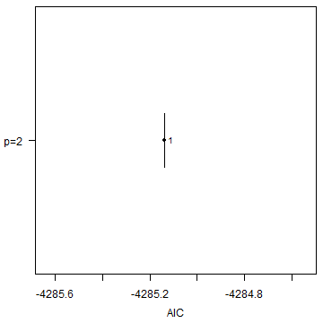
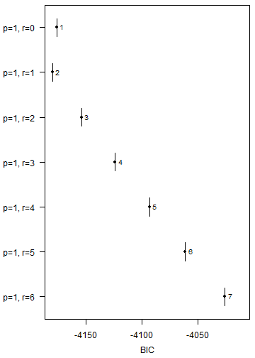
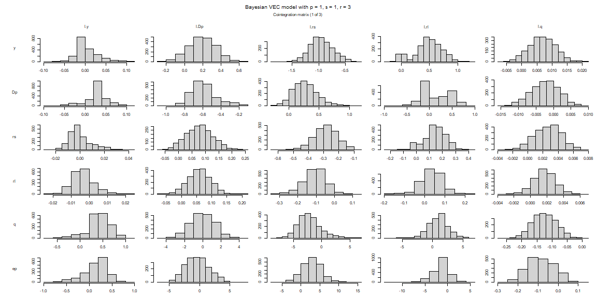
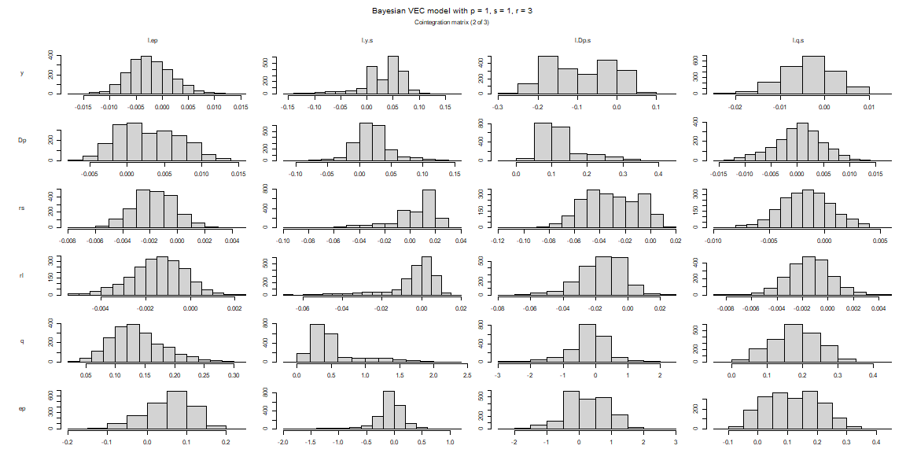
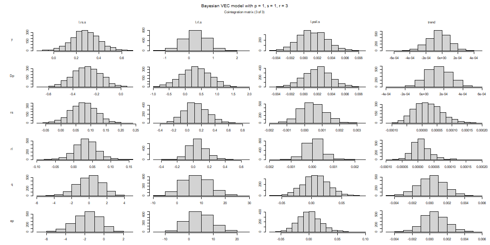
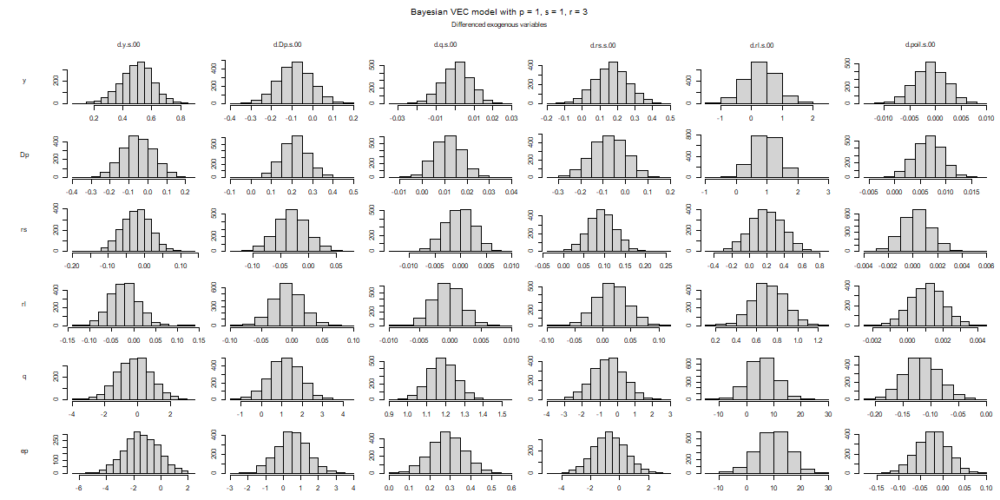
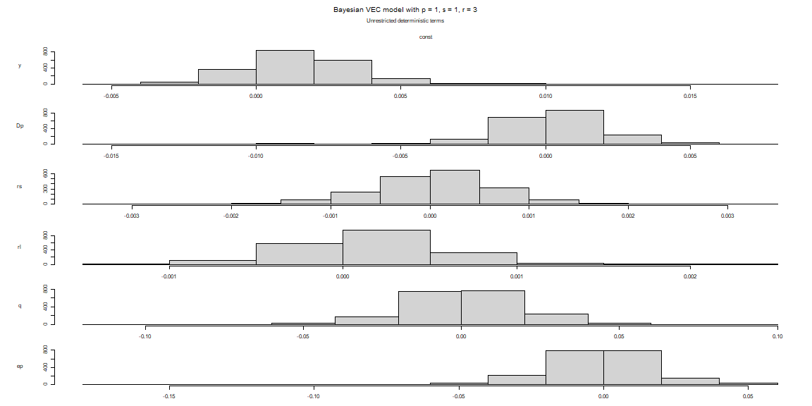
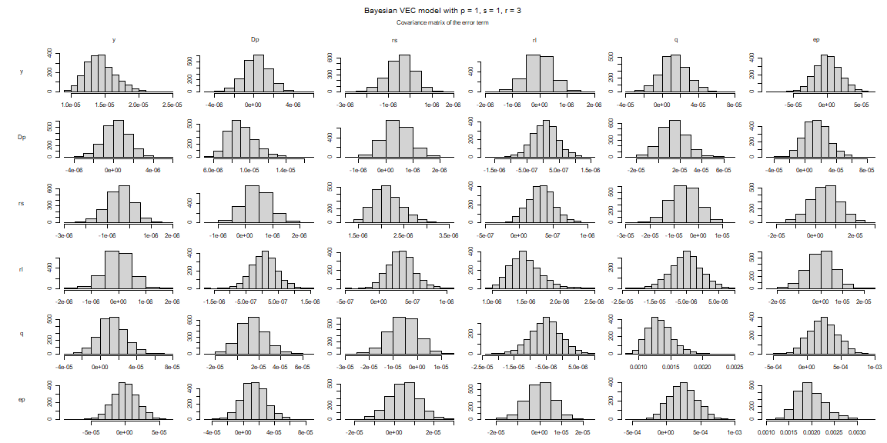

### Prepare GVEC data


``` r
library(bgvars)
data("dees2007")

submodel_data <- dees2007[["submodel_data"]]
global_data <- dees2007[["global_data"]]
```


``` r
# Add global series to US series
vars_us <- c(dimnames(submodel_data[["US"]][["endogen"]])[[2]], "poil")
submodel_data[["US"]][["endogen"]] <- cbind(submodel_data[["US"]][["endogen"]], global_data)
dimnames(submodel_data[["US"]][["endogen"]])[[2]] <- vars_us
```


``` r
object <- create_gvecmodel(submodel_data = submodel_data)
```

Weight matrices for each country/region can be calculated with the function `add_weight_matrices`.


``` r
# Generate weight matrices
object <- add_weight_matrices(object = object,
                              submodel_data = submodel_data,
                              period = 1999:2001)
```


### Model specification

#### Determine the number of lags


``` r
submodel <- create_varxsubmodel(object,
                                submodel = "EA",
                                endogen = c("y", "Dp", "rs", "rl", "q", "ep"),
                                p_endogen = 2,
                                exogen = c("y", "Dp", "q", "rs", "rl", "poil"),
                                p_exogen = 3,
                                deterministic = "const",
                                iterations = 2000,
                                burnin = 1000)
```


### Prior specification


``` r
submodel <- add_priors(submodel,
                       coef = list(v_i = 0),
                       sigma = list(df = 3, scale = 0.0001))
```

### Initial values


``` r
submodel <- add_initial_values(submodel)
```

### Posterior simulation


``` r
submodel <- add_posterior_coefficients(submodel)
```


``` r
submodel <- add_posterior_loglik(submodel)
```

### Model selection


``` r
sc <- selection_criteria(submodel)
```


``` r
sc
#> 
#> ------------------------------------------
#> In-sample
#> ------------------------------------------
#> 
#> Log-likelihood
#> 
#>          Mean Median Quantile (2.5%) Quantile (97.5%)
#>  Model 1 2242   2242            2210             2273
#> 
#> 
#> Akaike Information Criterion (AIC)
#> 
#>           Mean Median Quantile (2.5%) Quantile (97.5%)
#>  Model 1 -4205  -4205                                 
#> 
#> 
#> Bayesian Information Criterion (BIC)
#> 
#>           Mean Median Quantile (2.5%) Quantile (97.5%)
#>  Model 1 -3672  -3672                                 
#> 
#> 
#> Hannan-Quinn Criterion (HQ)
#> 
#>           Mean Median Quantile (2.5%) Quantile (97.5%)
#>  Model 1 -3990  -3990                                 
#> 
#> 
#> Widely Applicable Information Criterion (WAIC)
#> 
#>           Mean Median Quantile (2.5%) Quantile (97.5%)
#>  Model 1 -4314  -4314           -4379            -4249
#> 
#> Periods with a pointwise log-likelihood variance above 0.4, which makes the correction of WAIC, AIC, BIC and HQ unreliable, in model 1 (92).
#> 
#> 
#> Leave-One-Out Information Criterion (LOOIC)
#> 
#>           Mean Median Quantile (2.5%) Quantile (97.5%)
#>  Model 1 -4289  -4289           -4358            -4220
#> 
#> Influential periods, whose importance sampling is unreliable, in model 1 (37), counted as a Pareto k above 0.7.
```


``` r
plot(sc, criterion = "AIC")
```




#### Determine the rank


``` r
submodel <- create_vecxsubmodel(object,
                                submodel = "EA",
                                endogen = c("y", "Dp", "rs", "rl", "q", "ep"),
                                p_endogen = 1,
                                exogen = c("y", "Dp", "q", "rs", "rl", "poil"),
                                p_exogen = 1,
                                r = NULL,
                                const = "unrestricted",
                                trend = "restricted",
                                iterations = 2000,
                                burnin = 1000)
#> Argument rank 'r' not specified. Generating models for r = 0, 1, 2, 3, 4, 5, 6.
```


### Prior specification


``` r
submodel <- add_priors(submodel,
                     coef = list(v_i = 0),
                     coint = list(v_i = 0, p_tau_i = 1),
                     sigma = list(df = 3, scale = 0.0001))
```

### Initial values


``` r
submodel <- add_initial_values(submodel)
```

### Posterior simulation


``` r
submodel <- add_posterior_coefficients(submodel)
```


``` r
submodel <- add_posterior_loglik(submodel)
```

### Model selection


``` r
sc <- selection_criteria(submodel)
```


``` r
sc
#> 
#> ------------------------------------------
#> In-sample
#> ------------------------------------------
#> 
#> Log-likelihood
#> 
#>          Mean Median Quantile (2.5%) Quantile (97.5%)
#>  Model 1 2208   2208            2189             2224
#>  Model 2 2243   2243            2223             2261
#>  Model 3 2257   2258            2236             2277
#>  Model 4 2269   2270            2247             2289
#>  Model 5 2279   2280            2256             2301
#>  Model 6 2285   2285            2262             2307
#>  Model 7 2284   2285            2262             2305
#> 
#> 
#> Akaike Information Criterion (AIC)
#> 
#>           Mean Median Quantile (2.5%) Quantile (97.5%)
#>  Model 1 -4339  -4339                                 
#>  Model 2 -4389  -4389                                 
#>  Model 3 -4405  -4405                                 
#>  Model 4 -4411  -4411                                 
#>  Model 5 -4411  -4411                                 
#>  Model 6 -4405  -4405                                 
#>  Model 7 -4391  -4391                                 
#> 
#> 
#> Bayesian Information Criterion (BIC)
#> 
#>           Mean Median Quantile (2.5%) Quantile (97.5%)
#>  Model 1 -4176  -4176                                 
#>  Model 2 -4179  -4179                                 
#>  Model 3 -4154  -4154                                 
#>  Model 4 -4124  -4124                                 
#>  Model 5 -4093  -4093                                 
#>  Model 6 -4061  -4061                                 
#>  Model 7 -4026  -4026                                 
#> 
#> 
#> Hannan-Quinn Criterion (HQ)
#> 
#>           Mean Median Quantile (2.5%) Quantile (97.5%)
#>  Model 1 -4273  -4273                                 
#>  Model 2 -4304  -4304                                 
#>  Model 3 -4303  -4303                                 
#>  Model 4 -4295  -4295                                 
#>  Model 5 -4282  -4282                                 
#>  Model 6 -4266  -4266                                 
#>  Model 7 -4243  -4243                                 
#> 
#> 
#> Widely Applicable Information Criterion (WAIC)
#> 
#>           Mean Median Quantile (2.5%) Quantile (97.5%)
#>  Model 1 -4359  -4359           -4438            -4281
#>  Model 2 -4412  -4412           -4494            -4329
#>  Model 3 -4417  -4417           -4502            -4332
#>  Model 4 -4428  -4428           -4514            -4341
#>  Model 5 -4443  -4443           -4528            -4358
#>  Model 6 -4451  -4451           -4537            -4364
#>  Model 7 -4446  -4446           -4534            -4358
#> 
#> Periods with a pointwise log-likelihood variance above 0.4, which makes the correction of WAIC, AIC, BIC and HQ unreliable, in models 1 (33), 2 (43), 3 (63), 4 (69), 5 (76), 6 (76), 7 (77).
#> 
#> 
#> Leave-One-Out Information Criterion (LOOIC)
#> 
#>           Mean Median Quantile (2.5%) Quantile (97.5%)
#>  Model 1 -4358  -4358           -4437            -4279
#>  Model 2 -4408  -4408           -4491            -4325
#>  Model 3 -4410  -4410           -4496            -4325
#>  Model 4 -4422  -4422           -4509            -4335
#>  Model 5 -4435  -4435           -4521            -4348
#>  Model 6 -4444  -4444           -4531            -4357
#>  Model 7 -4437  -4437           -4526            -4349
#> 
#> Influential periods, whose importance sampling is unreliable, in models 1 (2), 2 (7), 3 (12), 4 (14), 5 (10), 6 (14), 7 (16), counted as a Pareto k above 0.7.
```


``` r
plot(sc, criterion = "BIC")
```




``` r
result <- submodel[[4]]
```


``` r
summary(result)
#> 
#> Bayesian VEC model with p = 1 and s = 1 
#> 
#> Endogenous variables: y, Dp, rs, rl, q, ep
#> 
#> Variable: y 
#> 
#>                      Mean           SD     Naive SD Time-series SD
#> l.y          2.037137e-02 0.0430183777 9.619202e-04   1.592275e-03
#> l.Dp         1.801365e-01 0.1562997615 3.494969e-03   4.945431e-03
#> l.rs        -1.089163e+00 0.2860744709 6.396820e-03   8.053083e-03
#> l.rl         4.151531e-01 0.4156916323 9.295147e-03   1.161795e-02
#> l.q          5.891533e-03 0.0053968783 1.206779e-04   1.746765e-04
#> l.ep        -2.672975e-03 0.0045644014 1.020631e-04   1.496788e-04
#> l.y.s       -2.340295e-02 0.0438237238 9.799283e-04   1.614708e-03
#> l.Dp.s      -7.234520e-02 0.0970845837 2.170877e-03   3.789287e-03
#> l.q.s       -2.191696e-03 0.0074472408 1.665254e-04   2.594517e-04
#> l.rs.s       2.815950e-01 0.1238230850 2.768768e-03   4.642071e-03
#> l.rl.s       2.545763e-01 0.4811667392 1.075922e-02   1.498805e-02
#> l.poil.s     1.292890e-03 0.0020545211 4.594049e-05   6.131297e-05
#> trend       -4.441512e-05 0.0001340153 2.996674e-06   5.493458e-06
#> d.y.s.00     4.610538e-01 0.1211644796 2.709320e-03   4.482087e-03
#> d.Dp.s.00   -7.999687e-02 0.0882294359 1.972870e-03   2.813146e-03
#> d.q.s.00    -1.341910e-03 0.0078574486 1.756979e-04   2.548702e-04
#> d.rs.s.00    1.755600e-01 0.1002475367 2.241603e-03   2.660472e-03
#> d.rl.s.00    3.949706e-01 0.5288542099 1.182554e-02   1.350592e-02
#> d.poil.s.00 -1.779571e-03 0.0033204660 7.424788e-05   8.371540e-05
#> const        1.484428e-03 0.0019413204 4.340924e-05   2.046398e-04
#>                      2.5%           50%         97.5%  
#> l.y         -0.0680947547  0.0219813684  0.1035259581  
#> l.Dp        -0.1245447136  0.1828857230  0.4849065441  
#> l.rs        -1.6592646874 -1.0819926704 -0.5284493650 *
#> l.rl        -0.3927433596  0.4073502986  1.2515858005  
#> l.q         -0.0045764955  0.0057590104  0.0165599038  
#> l.ep        -0.0118534525 -0.0025410586  0.0060475655  
#> l.y.s       -0.1070678216 -0.0255035849  0.0675583373  
#> l.Dp.s      -0.2664586880 -0.0749771141  0.1162784773  
#> l.q.s       -0.0164102495 -0.0021291798  0.0123666793  
#> l.rs.s       0.0333194900  0.2781021732  0.5337432136 *
#> l.rl.s      -0.7145521665  0.2605088999  1.1961441165  
#> l.poil.s    -0.0025965918  0.0012518344  0.0055065331  
#> trend       -0.0003253723 -0.0000367511  0.0002029722  
#> d.y.s.00     0.2276190347  0.4617515518  0.7006853158 *
#> d.Dp.s.00   -0.2523835744 -0.0828110758  0.1003672608  
#> d.q.s.00    -0.0169690615 -0.0013479915  0.0137606914  
#> d.rs.s.00   -0.0197024432  0.1753841284  0.3777680227  
#> d.rl.s.00   -0.6674559588  0.3803420060  1.4534568121  
#> d.poil.s.00 -0.0080310283 -0.0017658734  0.0049201189  
#> const       -0.0020188647  0.0014300477  0.0054400663  
#> 
#> Variable: Dp 
#> 
#>                      Mean           SD     Naive SD Time-series SD
#> l.y          0.0539018377 0.0415999064 9.302022e-04   1.766444e-03
#> l.Dp        -0.6398379653 0.1447785994 3.237348e-03   5.915930e-03
#> l.rs         0.2596536208 0.2663239218 5.955184e-03   7.908243e-03
#> l.rl        -0.0394076659 0.3984653836 8.909957e-03   1.087696e-02
#> l.q         -0.0029756672 0.0046088770 1.030576e-04   1.634740e-04
#> l.ep         0.0040758818 0.0040469507 9.049257e-05   1.391569e-04
#> l.y.s       -0.0541082140 0.0425908068 9.523594e-04   1.881353e-03
#> l.Dp.s       0.1972460230 0.0945890900 2.115076e-03   3.762752e-03
#> l.q.s        0.0047009854 0.0061899270 1.384110e-04   2.227129e-04
#> l.rs.s      -0.2847554925 0.1156397407 2.585783e-03   4.585763e-03
#> l.rl.s       0.3282923168 0.4582707156 1.024724e-02   1.593544e-02
#> l.poil.s     0.0019728867 0.0019568825 4.375722e-05   5.648464e-05
#> trend        0.0001454320 0.0001282864 2.868571e-06   5.272543e-06
#> d.y.s.00    -0.0697505194 0.1018362849 2.277129e-03   4.050793e-03
#> d.Dp.s.00    0.2525251791 0.0774932119 1.732801e-03   2.868003e-03
#> d.q.s.00     0.0129337308 0.0063563993 1.421334e-04   1.951763e-04
#> d.rs.s.00   -0.0968021806 0.0842291503 1.883421e-03   2.481694e-03
#> d.rl.s.00    1.0146413868 0.4509752238 1.008411e-02   1.204192e-02
#> d.poil.s.00  0.0049401376 0.0026872525 6.008879e-05   7.137644e-05
#> const        0.0001933325 0.0020398930 4.561340e-05   2.291512e-04
#>                      2.5%           50%         97.5%  
#> l.y         -2.436304e-02  0.0542780662  0.1372225126  
#> l.Dp        -8.993323e-01 -0.6495825795 -0.3178507642 *
#> l.rs        -2.743109e-01  0.2640343492  0.7629521039  
#> l.rl        -8.331584e-01 -0.0472999032  0.7706313492  
#> l.q         -1.199313e-02 -0.0030216667  0.0061285138  
#> l.ep        -3.705953e-03  0.0041154617  0.0118423148  
#> l.y.s       -1.402772e-01 -0.0541991563  0.0254808011  
#> l.Dp.s       2.256834e-02  0.1968972863  0.3815981632 *
#> l.q.s       -7.815754e-03  0.0047299535  0.0165598112  
#> l.rs.s      -5.100335e-01 -0.2864079705 -0.0581311903 *
#> l.rl.s      -5.879464e-01  0.3318881857  1.1895511957  
#> l.poil.s    -1.834867e-03  0.0020511121  0.0059351571  
#> trend       -9.736271e-05  0.0001438856  0.0003942612  
#> d.y.s.00    -2.689271e-01 -0.0679919681  0.1269987663  
#> d.Dp.s.00    1.076545e-01  0.2514605198  0.3991927543 *
#> d.q.s.00     7.874965e-04  0.0129774707  0.0251996942 *
#> d.rs.s.00   -2.681216e-01 -0.0962408520  0.0650313562  
#> d.rl.s.00    9.977827e-02  1.0026951242  1.9384567896 *
#> d.poil.s.00 -4.021459e-04  0.0050495788  0.0099902417  
#> const       -4.018147e-03  0.0002915026  0.0038695830  
#> 
#> Variable: rs 
#> 
#>                      Mean           SD     Naive SD Time-series SD
#> l.y          1.575042e-02 1.574635e-02 3.520991e-04   7.145348e-04
#> l.Dp         7.182804e-02 6.341901e-02 1.418092e-03   2.913636e-03
#> l.rs        -3.473461e-01 1.138343e-01 2.545412e-03   3.486962e-03
#> l.rl         1.118990e-01 1.485754e-01 3.322247e-03   4.742179e-03
#> l.q          2.170865e-03 2.147851e-03 4.802740e-05   9.234276e-05
#> l.ep        -1.467528e-03 1.777320e-03 3.974209e-05   7.217759e-05
#> l.y.s       -1.806636e-02 1.626407e-02 3.636757e-04   7.516312e-04
#> l.Dp.s      -1.937571e-02 3.450157e-02 7.714786e-04   1.394494e-03
#> l.q.s       -9.454069e-04 3.034862e-03 6.786157e-05   1.377025e-04
#> l.rs.s       7.548516e-02 4.390666e-02 9.817828e-04   1.713796e-03
#> l.rl.s       1.273690e-01 1.775130e-01 3.969312e-03   7.686999e-03
#> l.poil.s     4.634672e-04 7.135043e-04 1.595444e-05   1.987867e-05
#> trend        2.067219e-05 4.717295e-05 1.054819e-06   2.142225e-06
#> d.y.s.00    -2.037284e-02 4.604450e-02 1.029586e-03   1.724747e-03
#> d.Dp.s.00   -2.187881e-02 3.243399e-02 7.252460e-04   1.105091e-03
#> d.q.s.00    -3.933723e-04 3.014414e-03 6.740434e-05   8.907549e-05
#> d.rs.s.00    9.053264e-02 3.636733e-02 8.131982e-04   9.367897e-04
#> d.rl.s.00    1.958747e-01 2.072181e-01 4.633537e-03   5.864280e-03
#> d.poil.s.00 -7.558516e-05 1.228966e-03 2.748052e-05   3.194021e-05
#> const        4.761569e-05 6.598728e-04 1.475520e-05   5.660658e-05
#>                      2.5%           50%         97.5%  
#> l.y         -1.267622e-02  1.484194e-02  0.0488981430  
#> l.Dp        -5.140439e-02  7.127847e-02  0.1952918924  
#> l.rs        -5.758602e-01 -3.427927e-01 -0.1334400369 *
#> l.rl        -1.692497e-01  1.094092e-01  0.4204948802  
#> l.q         -1.950004e-03  2.132731e-03  0.0064049189  
#> l.ep        -5.135549e-03 -1.391097e-03  0.0018020191  
#> l.y.s       -5.221722e-02 -1.699103e-02  0.0114816481  
#> l.Dp.s      -9.050126e-02 -1.902272e-02  0.0490005850  
#> l.q.s       -6.825618e-03 -9.821980e-04  0.0047386950  
#> l.rs.s      -1.203414e-02  7.640354e-02  0.1633207551  
#> l.rl.s      -1.943887e-01  1.201065e-01  0.4862668836  
#> l.poil.s    -8.138548e-04  4.392450e-04  0.0019323738  
#> trend       -6.077313e-05  1.784437e-05  0.0001213566  
#> d.y.s.00    -1.104666e-01 -2.065272e-02  0.0740872637  
#> d.Dp.s.00   -8.513126e-02 -2.306780e-02  0.0416710259  
#> d.q.s.00    -6.225956e-03 -4.782506e-04  0.0055831040  
#> d.rs.s.00    2.137079e-02  9.044472e-02  0.1638331259 *
#> d.rl.s.00   -2.066225e-01  1.968129e-01  0.6011263764  
#> d.poil.s.00 -2.495308e-03 -4.462934e-05  0.0022142809  
#> const       -1.306405e-03  7.039279e-05  0.0013249772  
#> 
#> Variable: rl 
#> 
#>                      Mean           SD     Naive SD Time-series SD
#> l.y          5.326192e-03 9.364094e-03 2.093875e-04   3.461889e-04
#> l.Dp         4.727932e-02 4.768464e-02 1.066261e-03   1.572165e-03
#> l.rs        -1.286692e-01 7.573213e-02 1.693422e-03   1.841932e-03
#> l.rl         2.630967e-02 8.607244e-02 1.924638e-03   2.363164e-03
#> l.q          8.882217e-04 1.392677e-03 3.114119e-05   4.951397e-05
#> l.ep        -6.747041e-04 1.105166e-03 2.471227e-05   3.829669e-05
#> l.y.s       -6.299098e-03 9.722561e-03 2.174031e-04   3.703581e-04
#> l.Dp.s      -1.142269e-02 2.139822e-02 4.784788e-04   6.554880e-04
#> l.q.s       -4.841051e-04 1.985270e-03 4.439200e-05   7.312798e-05
#> l.rs.s       3.337799e-02 2.973119e-02 6.648097e-04   8.406322e-04
#> l.rl.s       5.700932e-02 1.100432e-01 2.460642e-03   3.790720e-03
#> l.poil.s     8.516646e-05 4.034850e-04 9.022200e-06   1.023085e-05
#> trend        9.250084e-06 2.803874e-05 6.269653e-07   1.084290e-06
#> d.y.s.00    -2.362878e-02 3.551338e-02 7.941033e-04   1.104496e-03
#> d.Dp.s.00   -3.773004e-03 2.574613e-02 5.757009e-04   6.403701e-04
#> d.q.s.00    -6.874989e-07 2.413523e-03 5.396802e-05   5.726280e-05
#> d.rs.s.00    1.211539e-02 3.098399e-02 6.928232e-04   7.364278e-04
#> d.rl.s.00    7.098203e-01 1.632661e-01 3.650741e-03   4.074644e-03
#> d.poil.s.00  1.069601e-03 1.007547e-03 2.252944e-05   2.252944e-05
#> const        1.433614e-04 4.072317e-04 9.105978e-06   2.211418e-05
#>                      2.5%           50%        97.5%  
#> l.y         -1.192867e-02  4.537136e-03 2.603555e-02  
#> l.Dp        -4.462455e-02  4.802690e-02 1.380465e-01  
#> l.rs        -2.822480e-01 -1.268445e-01 1.971378e-02  
#> l.rl        -1.599648e-01  2.809824e-02 1.949000e-01  
#> l.q         -1.810185e-03  8.712960e-04 3.611643e-03  
#> l.ep        -2.968723e-03 -6.008145e-04 1.408566e-03  
#> l.y.s       -2.749706e-02 -5.242392e-03 1.112341e-02  
#> l.Dp.s      -5.397693e-02 -1.168932e-02 3.155502e-02  
#> l.q.s       -4.282840e-03 -4.891427e-04 3.507791e-03  
#> l.rs.s      -2.523650e-02  3.401726e-02 9.462277e-02  
#> l.rl.s      -1.424217e-01  4.815836e-02 2.941659e-01  
#> l.poil.s    -7.162954e-04  7.682951e-05 9.253281e-04  
#> trend       -3.864535e-05  5.875946e-06 7.266963e-05  
#> d.y.s.00    -9.228643e-02 -2.407492e-02 4.821538e-02  
#> d.Dp.s.00   -5.392627e-02 -3.931854e-03 4.677050e-02  
#> d.q.s.00    -4.627050e-03 -2.169147e-05 4.654170e-03  
#> d.rs.s.00   -4.902132e-02  1.293835e-02 7.289321e-02  
#> d.rl.s.00    3.888690e-01  7.083851e-01 1.022938e+00 *
#> d.poil.s.00 -9.287944e-04  1.067278e-03 3.014459e-03  
#> const       -6.988770e-04  1.629479e-04 9.087399e-04  
#> 
#> Variable: q 
#> 
#>                      Mean          SD     Naive SD Time-series SD          2.5%
#> l.y          0.1746842533 0.475664964 1.063619e-02   1.878892e-02  -0.751438512
#> l.Dp         0.0580033688 1.711503157 3.827037e-02   6.500317e-02  -3.245349989
#> l.rs        -1.2143499627 3.154420714 7.053499e-02   1.020629e-01  -7.426862506
#> l.rl        -3.8208874395 4.821200673 1.078053e-01   1.797717e-01 -13.806730248
#> l.q         -0.1160772341 0.065328641 1.460793e-03   3.146675e-03  -0.236788412
#> l.ep         0.0924961104 0.054541776 1.219591e-03   2.548186e-03  -0.007733068
#> l.y.s       -0.1035794950 0.490195485 1.096110e-02   2.000453e-02  -1.051410136
#> l.Dp.s       0.3581765564 1.112231691 2.487026e-02   4.702365e-02  -1.606549197
#> l.q.s        0.1938465301 0.089510622 2.001518e-03   4.591416e-03   0.002463226
#> l.rs.s       0.0360877991 1.409979619 3.152810e-02   6.053717e-02  -2.825230808
#> l.rl.s       7.8280105554 5.641731032 1.261529e-01   2.609829e-01  -2.640812743
#> l.poil.s     0.0067053008 0.021938680 4.905638e-04   6.360886e-04  -0.037219465
#> trend        0.0001952453 0.001501837 3.358209e-05   7.382537e-05  -0.002776928
#> d.y.s.00    -0.1308818771 1.264252413 2.826954e-02   5.379265e-02  -2.485814024
#> d.Dp.s.00    1.3903784725 0.958609953 2.143517e-02   3.726806e-02  -0.419828818
#> d.q.s.00     1.1689101338 0.081844884 1.830107e-03   2.796422e-03   1.007214389
#> d.rs.s.00   -0.3773253434 1.034528311 2.313276e-02   3.443461e-02  -2.390372639
#> d.rl.s.00    7.1924437911 5.525938264 1.235637e-01   1.667197e-01  -3.619394514
#> d.poil.s.00 -0.1243429611 0.032957033 7.369417e-04   8.605442e-04  -0.188403226
#> const        0.0015901078 0.018236988 4.077915e-04   1.335253e-03  -0.033280606
#>                       50%        97.5%  
#> l.y          0.1744640311  1.092985724  
#> l.Dp         0.0489331312  3.459601663  
#> l.rs        -1.2319446239  4.900400577  
#> l.rl        -3.5373110428  4.783603406  
#> l.q         -0.1167538041  0.009373566  
#> l.ep         0.0929020973  0.195057074  
#> l.y.s       -0.1048329038  0.854667901  
#> l.Dp.s       0.2937285890  2.754372007  
#> l.q.s        0.2005679820  0.354923095 *
#> l.rs.s       0.0947698764  2.634324734  
#> l.rl.s       7.6280346917 19.038252176  
#> l.poil.s     0.0066027870  0.049422969  
#> trend        0.0002322757  0.003101820  
#> d.y.s.00    -0.1607056844  2.452286375  
#> d.Dp.s.00    1.3915776227  3.336204801  
#> d.q.s.00     1.1715550959  1.321713991 *
#> d.rs.s.00   -0.3906559150  1.640970840  
#> d.rl.s.00    7.2079269113 17.813219889  
#> d.poil.s.00 -0.1240078164 -0.060888239 *
#> const        0.0009756903  0.037521738  
#> 
#> Variable: ep 
#> 
#>                      Mean          SD     Naive SD Time-series SD          2.5%
#> l.y          0.0907611409 0.461591972 1.032151e-02   1.920826e-02  -0.823507800
#> l.Dp        -0.8516515995 2.014938474 4.505539e-02   7.648239e-02  -4.752307095
#> l.rs         4.8388628085 3.394326261 7.589944e-02   1.094264e-01  -1.860761979
#> l.rl        -3.8391390469 4.319175167 9.657969e-02   1.513706e-01 -12.902715635
#> l.q         -0.1011752609 0.063553187 1.421092e-03   2.874677e-03  -0.225635510
#> l.ep         0.0635988388 0.051950658 1.161652e-03   2.246014e-03  -0.048749117
#> l.y.s       -0.0479650492 0.478404364 1.069745e-02   2.047605e-02  -1.003166144
#> l.Dp.s       0.6241617033 1.043896212 2.334223e-02   4.242909e-02  -1.390039313
#> l.q.s        0.1528709357 0.094330092 2.109285e-03   4.582680e-03  -0.027979748
#> l.rs.s      -1.7492687249 1.380617424 3.087154e-02   5.599111e-02  -4.601405305
#> l.rl.s       4.4007624708 5.279554479 1.180544e-01   2.265459e-01  -5.160963520
#> l.poil.s     0.0006860387 0.020764083 4.642990e-04   6.784821e-04  -0.038392221
#> trend        0.0005908963 0.001398257 3.126597e-05   6.303503e-05  -0.002108064
#> d.y.s.00    -1.2247641614 1.369618828 3.062561e-02   5.033689e-02  -3.845610255
#> d.Dp.s.00    0.7440433305 0.995591331 2.226210e-02   3.303954e-02  -1.179196933
#> d.q.s.00     0.3127384057 0.093647249 2.094016e-03   2.619531e-03   0.133539283
#> d.rs.s.00   -0.8529553335 1.160024769 2.593894e-02   3.586660e-02  -3.133534843
#> d.rl.s.00   11.0779882170 6.041510827 1.350923e-01   1.448020e-01  -0.751902412
#> d.poil.s.00 -0.0266068905 0.037089743 8.293519e-04   8.734043e-04  -0.098013223
#> const       -0.0015698838 0.018246548 4.080052e-04   1.113000e-03  -0.038559160
#>                       50%        97.5%  
#> l.y          0.0688819642  1.024076567  
#> l.Dp        -0.9254335339  3.058484171  
#> l.rs         4.8250753448 11.288317182  
#> l.rl        -3.6803005052  4.762103747  
#> l.q         -0.1022159840  0.025297374  
#> l.ep         0.0642787790  0.163386712  
#> l.y.s       -0.0257289013  0.880803782  
#> l.Dp.s       0.5993297211  2.716678819  
#> l.q.s        0.1561933382  0.335199360  
#> l.rs.s      -1.6902382961  0.845435603  
#> l.rl.s       4.1240276268 15.567128229  
#> l.poil.s    -0.0001352202  0.046537931  
#> trend        0.0005039664  0.003480109  
#> d.y.s.00    -1.2276805681  1.528212348  
#> d.Dp.s.00    0.7421228506  2.689976365  
#> d.q.s.00     0.3141481843  0.499085378 *
#> d.rs.s.00   -0.8349418613  1.450014306  
#> d.rl.s.00   11.0794789809 23.178327354  
#> d.poil.s.00 -0.0264901311  0.047242298  
#> const       -0.0005708633  0.031731390  
#> 
#> Variance-covariance matrix:
#> 
#>                Mean           SD     Naive SD Time-series SD          2.5%
#> y_y    1.486089e-05 2.463166e-06 5.507806e-08   7.169233e-08  1.088126e-05
#> y_Dp   4.979391e-07 1.320864e-06 2.953542e-08   3.699503e-08 -2.072317e-06
#> y_rs  -3.050139e-07 6.228405e-07 1.392714e-08   1.779024e-08 -1.493875e-06
#> y_rl  -8.949971e-08 5.161797e-07 1.154213e-08   1.374969e-08 -1.149300e-06
#> y_q    1.755616e-05 1.756640e-05 3.927966e-07   6.016250e-07 -1.573531e-05
#> y_ep   2.053772e-06 1.934043e-05 4.324651e-07   6.489359e-07 -3.572867e-05
#> Dp_Dp  9.220623e-06 1.574344e-06 3.520340e-08   4.976552e-08  6.759772e-06
#> Dp_rs  3.351164e-07 5.143454e-07 1.150111e-08   1.623438e-08 -6.771020e-07
#> Dp_rl -6.268510e-08 4.041025e-07 9.036007e-09   1.096300e-08 -8.608375e-07
#> Dp_q   1.768701e-05 1.355175e-05 3.030262e-07   4.379703e-07 -7.769673e-06
#> Dp_ep  1.066598e-05 1.571592e-05 3.514187e-07   4.696414e-07 -1.831579e-05
#> rs_rs  2.092550e-06 3.274415e-07 7.321814e-09   8.954609e-09  1.549741e-06
#> rs_rl  2.885321e-07 2.008900e-07 4.492037e-09   5.473407e-09 -1.011183e-07
#> rs_q  -5.089753e-06 6.524261e-06 1.458869e-07   2.067359e-07 -1.786779e-05
#> rs_ep  4.695456e-06 7.251898e-06 1.621574e-07   2.429638e-07 -9.434768e-06
#> rl_rl  1.498532e-06 2.211582e-07 4.945248e-09   5.451585e-09  1.120571e-06
#> rl_q  -6.994197e-06 5.211002e-06 1.165216e-07   1.487179e-07 -1.752813e-05
#> rl_ep -1.838205e-07 5.948693e-06 1.330168e-07   1.576189e-07 -1.215755e-05
#> q_q    1.466214e-03 2.458381e-04 5.497106e-06   8.833018e-06  1.063392e-03
#> q_ep   2.100768e-04 1.984708e-04 4.437942e-06   6.488544e-06 -1.643913e-04
#> ep_ep  1.928900e-03 3.136138e-04 7.012618e-06   9.600960e-06  1.404664e-03
#>                 50%        97.5%  
#> y_y    1.458117e-05 2.049285e-05 *
#> y_Dp   5.090664e-07 3.086945e-06  
#> y_rs  -3.178864e-07 9.726633e-07  
#> y_rl  -7.718831e-08 9.212939e-07  
#> y_q    1.643573e-05 5.293411e-05  
#> y_ep   1.562296e-06 4.038097e-05  
#> Dp_Dp  9.013751e-06 1.287539e-05 *
#> Dp_rs  3.122204e-07 1.392717e-06  
#> Dp_rl -6.274879e-08 7.502918e-07  
#> Dp_q   1.729603e-05 4.573803e-05  
#> Dp_ep  1.056777e-05 4.114228e-05  
#> rs_rs  2.062776e-06 2.845900e-06 *
#> rs_rl  2.859770e-07 6.987486e-07  
#> rs_q  -5.001504e-06 7.651068e-06  
#> rs_ep  4.667542e-06 1.965844e-05  
#> rl_rl  1.485410e-06 2.004606e-06 *
#> rl_q  -6.931872e-06 3.332664e-06  
#> rl_ep -9.529828e-08 1.106484e-05  
#> q_q    1.443777e-03 2.001406e-03 *
#> q_ep   2.030206e-04 6.109817e-04  
#> ep_ep  1.895845e-03 2.649506e-03 *
```

``` r
plot(result)
```














## References

Chudik, A. & Pesaran, M. H. (2016). Theory and practice of GVAR modelling. *Journal of Economic Surveys 30*(1), 165-197. <https://doi.org/10.1111/joes.12095>

Dees, S., Mauro, F., Pesaran, M. H., & Smith, V. L. (2007). Exploring the international linkages of the euro area: A global VAR analysis. *Journal of Applied Econometrics 22*(1), 1-38. <https://doi.org/10.1002/jae.932>

George, E. I., Sun, D., & Ni, S. (2008). Bayesian stochastic search for VAR model restrictions. *Journal of Econometrics, 142*(1), 553-580. <https://doi.org/10.1016/j.jeconom.2007.08.017>

Koop, G., Pesaran, M. H., & Potter, S.M. (1996). Impulse response analysis in nonlinear multivariate models. *Journal of Econometrics 74*(1), 119-147. <https://doi.org/10.1016/0304-4076(95)01753-4>

Lütkepohl, H. (2007). *New introduction to multiple time series analysis* (2nd ed.). Berlin: Springer.

Mohaddes, K., & Raissi, M. (2020). Compilation, revision and updating of the global VAR (GVAR) database, 1979Q2--2019Q4 (mimeo). <https://www.mohaddes.org/gvar>.

Pesaran, H. H., & Shin, Y. (1998). Generalized impulse response analys is in linear multivariate models. *Economics Letters, 58*(1), 17-29. <https://doi.org/10.1016/S0165-1765(97)00214-0>

Pesaran, M., Schuermann, T., & Weiner, S. M. (2004). Modeling regional interdependencies using a global error-correcting macroeconometric model. *Journal of Business & Economic Statistics 22*(2), 129-162. <https://doi.org/10.1198/073500104000000019>

[^gvar2019]: The paper and data set can be downloaded from <https://www.mohaddes.org/gvar>.
